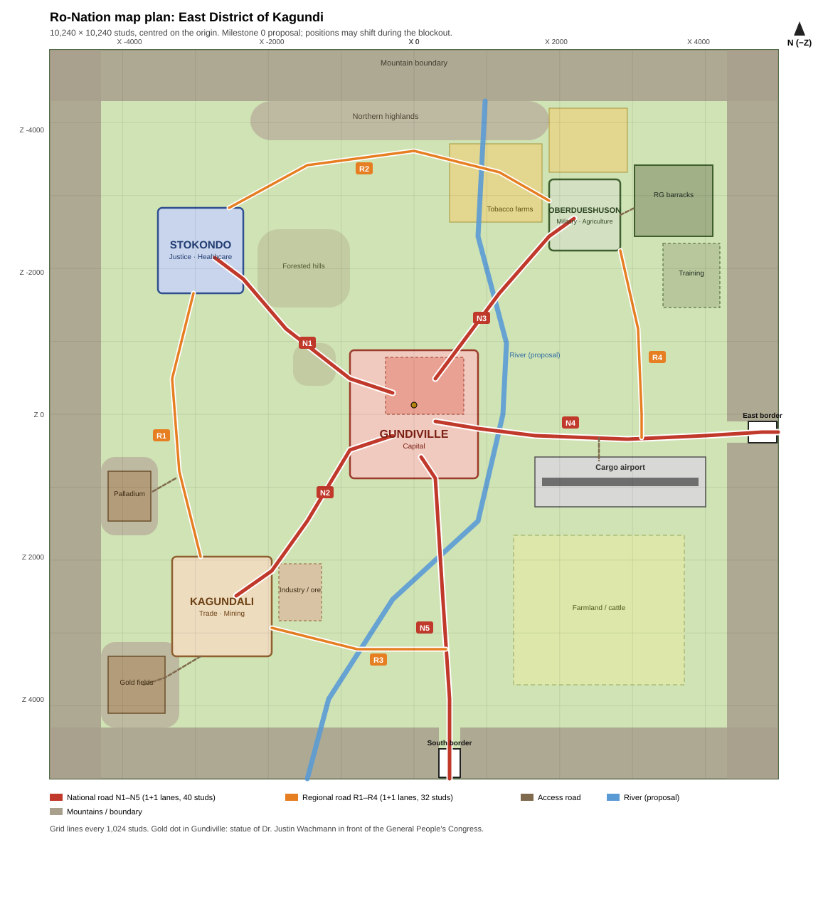
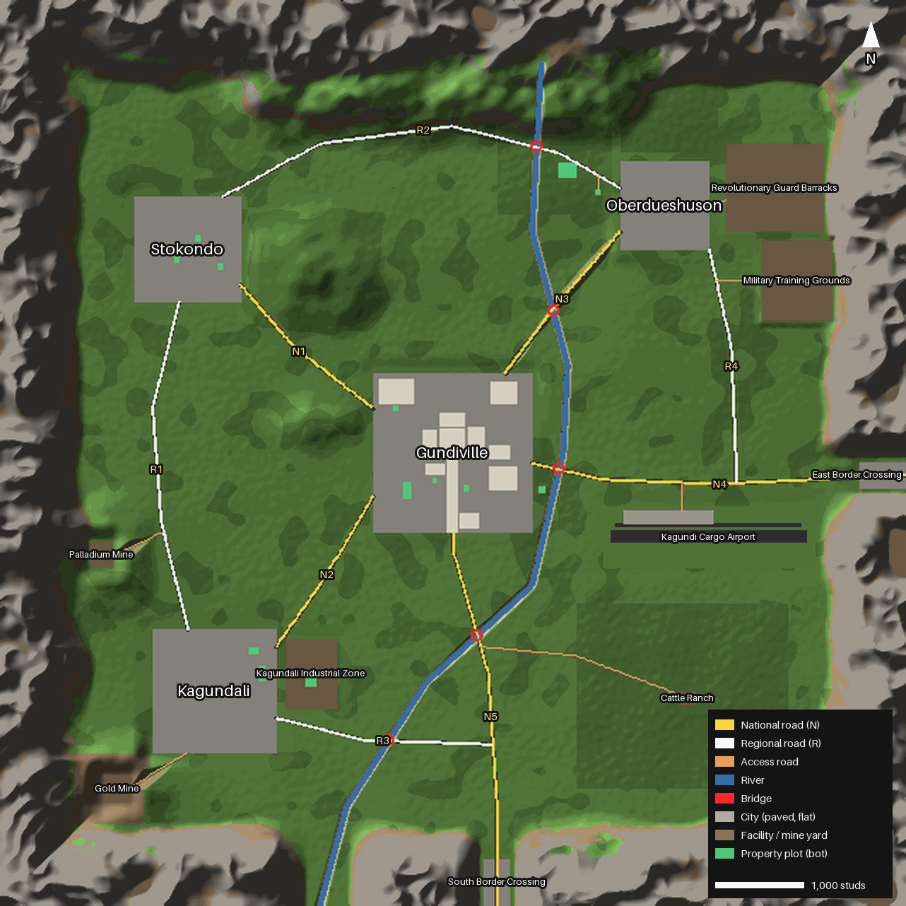
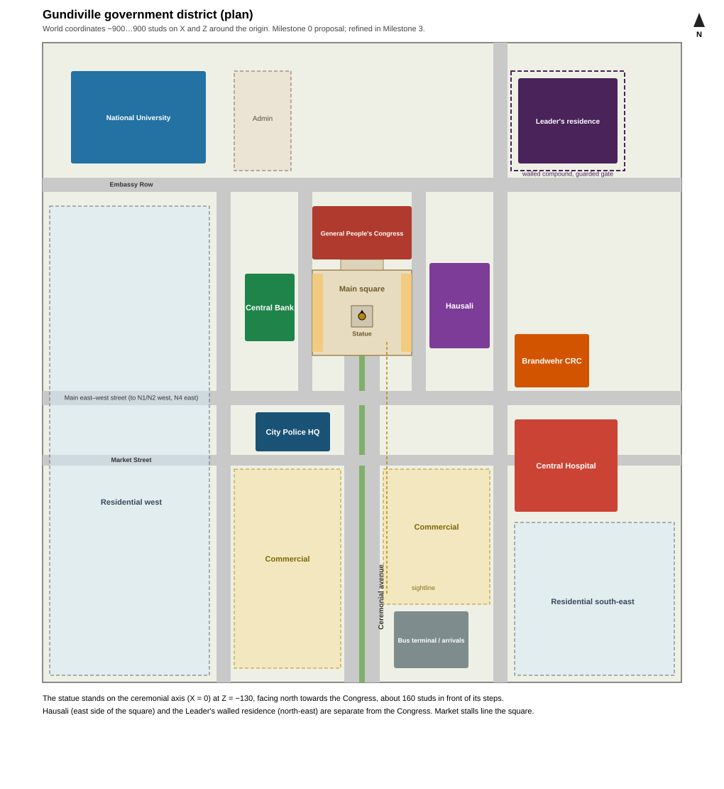
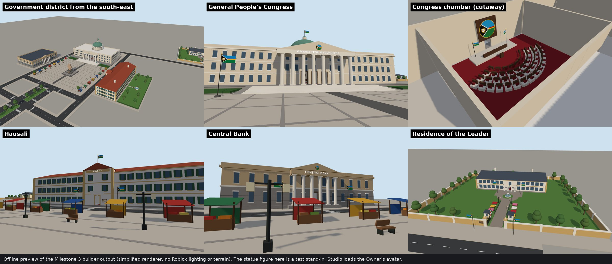

# 02 · Map Plan: East District of Kagundi

Status: proposed in Milestone 0, **blockout built in Milestone 2** (2026-10-26; Justin's Studio test is pending). Since Milestone 2, [`src/shared/Config/MapLayout.luau`](../../src/shared/Config/MapLayout.luau) is the single source for coordinates: change a number there, not in a builder, and note it here. Where the blockout differs from the original plan, section 12 says so.

Blockout as generated from `MapLayout` (rendered offline by `tests/map/preview.py`; the place file in Studio is the real result):

## 1. Canon this plan follows

From the Kagundi Encyclopedia (authoritative) and the Lore Bible:

- Landlocked, mostly mountainous: high plateaus, forested hills, valleys, rolling farmland.
- The capital and **all major cities lie in the East District**. The map therefore shows the East District.
- Mines and industrial sites lie **outside** the commercial centres; tobacco farms and cattle ranches fill the rural districts.
- A **cargo airport near the capital**, **international border crossings with customs posts**, and **roads linking every major city**.
- Gundiville (capital), Stokondo (justice and healthcare), Kagundali (trade and mining, site of the 1917 strike), Oberdueshuson (military and agriculture, garrison town since the Schutztruppe, starting point of the 1982 revolution).

Justin's **City Development Reference Guide** (26 Oct 2026, project files `lore/Ro-Nation_Kagundi_City_References.pdf`) adds visual direction and gameplay priorities. Its illustrations are concept art, not canon; the encyclopedia still decides names, institutions and history. Its requirements are folded into sections 5, 6 and 11 below.

## 2. Coordinate system and scale

| Item | Value |
|---|---|
| Map size | 10,240 × 10,240 studs (X and Z from −5,120 to +5,120), centred on the origin to avoid floating-point jitter far from (0, 0, 0) |
| Directions | **North = −Z**, East = +X, South = +Z, West = −X (*proposal*; matches Studio's default camera) |
| Scale | Roblox characters are about 5 studs tall, so 1 stud ≈ 0.28 m. Distances between cities are compressed for gameplay; buildings keep realistic proportions. |
| Playable area | Inside the mountain boundary, roughly −4,400 to +4,400 on both axes (about 8,800 studs across) |
| Boundary | A ring of steep mountains 720 studs wide, with passes only at the two border crossings. Invisible walls only where the terrain cannot stop players. |
| Heights | Valley floors Y 40–100, highland plateau Y 180, hills Y 250–450, boundary mountains Y 560–940 (as built) |

Why this size: with 20–25 players, a much larger map feels empty, while a smaller one cannot hold four distinct cities, an airport and real countryside. At a typical car speed of about 90 studs per second, the plan gives drives of roughly 40–70 seconds between neighbouring cities, long enough to feel like travel and short enough for emergency services. Walking between cities is possible but slow (16 studs per second), which makes vehicles meaningful.

## 3. Places and footprints

Footprints are axis-aligned rectangles given as X range × Z range.

| Area | Centre (X, Z) | Footprint | Ground Y | Notes |
|---|---|---|---|---|
| **Gundiville** | (0, 0) | −900…900 × −900…900 | 60 | Capital in a central basin. Government district in the north-east quarter, see section 5 |
| Cargo airport | (2,900, 950) | 1,700…4,100 × 600…1,300 | 60 | Runway about 2,200 × 120 studs, east–west. Cargo apron and terminal on the north side, access from N4 |
| **Stokondo** | (−3,000, −2,300) | −3,600…−2,400 × −2,900…−1,700 | 100 | North-west. Second-instance court, judicial administration and archive, major polyclinic |
| **Kagundali** | (−2,700, 2,700) | −3,400…−2,000 × 2,000…3,400 | 40 | South-west lowland valley. Commercial centre, trading companies, warehouses, freight yard |
| Kagundali industry and ore processing | (−1,600, 2,500) | −1,900…−1,300 × 2,100…2,900 | 40 | Between the city and N2; outside the commercial centre as the canon requires |
| Gold fields | (−3,900, 3,800) | −4,300…−3,500 × 3,400…4,200 | 80–200 | Hill mines south-west of Kagundali with haul roads; diamond workings nearby |
| Palladium mine | (−4,000, 1,150) | −4,300…−3,700 × 800…1,500 | 120 | West hills "near Kagundali" (1973 Concession Scandal) |
| **Oberdueshuson** | (2,400, −2,800) | 1,900…2,900 × −3,300…−2,300 | 180 | North-east highland plateau; garrison town |
| Revolutionary Guard main barracks | (3,650, −3,000) | 3,100…4,200 × −3,500…−2,500 | 180 | Barracks, military administration, vehicle and equipment depot |
| Military training grounds | (3,900, −1,950) | 3,500…4,300 × −2,400…−1,500 | 170 | Firing range, drill ground, obstacle course |
| Tobacco farms | — | 500…1,800 × −3,800…−2,700 and 1,900…3,000 × −4,300…−3,400 | 150–200 | Farms and rural settlements around Oberdueshuson |
| Farmland and cattle ranches | (2,600, 2,750) | 1,400…3,800 × 1,700…3,800 | 50–80 | South-east lowland, rural settlements |
| East border crossing | (4,900, 250) | 4,700…5,100 × 100…400 | 60 | International; customs post. Neighbouring country unnamed (*open question*) |
| South border crossing | (500, 4,900) | 350…650 × 4,700…5,100 | 50 | International; customs post and truck inspection for freight from Kagundali |
| Northern highlands | — | −2,300…1,900 × −4,400…−3,850 | 300–450 | Mountain pass for R2 |
| Forested hills | — | −2,200…−900 × −2,600…−1,500 | 150–300 | Between Gundiville and Stokondo |
| River (*proposal*, unnamed) | — | from (1,000, −4,400) south past Gundiville to (−1,500, 5,120) | — | Five bridges (R2, N3, N4, N5, R3). Can be dropped if it costs too much performance |

## 4. Road network

All four cities are connected through a hub (Gundiville) plus an outer ring, so every city can be reached by at least two routes. That matters for emergency services and for roleplay roadblocks. Road numbers are labels for development (*proposal*), not canon names.

| Road | Class | Route | Approx. length (studs) | Notes |
|---|---|---|---|---|
| N1 | National | Gundiville ↔ Stokondo | 3,200 | Through the forested hills, climbs 40 studs |
| N2 | National | Gundiville ↔ Kagundali | 3,300 | Passes the industrial zone |
| N3 | National | Gundiville ↔ Oberdueshuson | 3,000 | Climbs 120 studs to the plateau (about 4%); river bridge |
| N4 | National | Gundiville ↔ cargo airport ↔ East border | 4,800 | Main freight and airport road; river bridge |
| N5 | National | Gundiville ↔ South border | 4,600 | River bridge; R3 joins it |
| R1 | Regional | Stokondo ↔ Kagundali (west valley) | 3,800 | Access to the palladium mine |
| R2 | Regional | Stokondo ↔ Oberdueshuson (northern pass) | 4,800 | Highest road, pass at about Y 300 |
| R3 | Regional | Kagundali ↔ N5 | 2,500 | Freight route from Kagundali to the south border; river bridge |
| R4 | Regional | Oberdueshuson ↔ N4 near the airport | 2,700 | Military road past the training grounds |
| Access | Local | Mines, farms, barracks, airport apron | — | Gravel or narrow asphalt |

Road standards (*proposal*, tested with vehicles in Milestones 2 and 4):

| Class | Width | Lanes | Max gradient | Min curve radius |
|---|---|---|---|---|
| National (N) | 40 studs (2 × 16-stud lanes + shoulders) | 1 + 1 | 6% | 150 studs |
| Regional (R) | 32 studs | 1 + 1 | 10% | 90 studs |
| City avenue | 100 studs incl. median and sidewalks | 2 + 2 | 4% | — |
| City street | 40 studs incl. sidewalks | 1 + 1 | 8% | — |
| Access road | 20–24 studs | shared | 12% | 40 studs |

Every route ends in a city, a facility, a border crossing or a turning area; none ends in a cliff.

## 5. Gundiville government district

Coordinates in studs, world space (Gundiville is centred on the origin).

| Element | Footprint (X × Z) | Faces | Notes |
|---|---|---|---|
| Ceremonial avenue | −50…50 × −20…900 | — | Main approach from the south, tree-lined median, ends at the square |
| Main square (ceremonial and market square) | −140…140 × −260…−20 | — | Market stalls along the east and west edges, parade space in the middle |
| **Statue of Dr. Justin Wachmann** | platform −30…30 × −160…−100, figure at (0, −130) | north, towards the Congress | On the ceremonial axis directly in front of the Congress, visible along the whole avenue and from the Congress entrance. Facing the Congress as in Justin's city reference guide |
| **General People's Congress** | −140…140 × −440…−290 | south | Spans the north end of the square; forecourt and ceremonial steps at Z −290…−260. Tallest building of the district (central dome or tower) |
| **Hausali** (government headquarters) | 190…360 × −280…−40 | west, onto the square | Administrative style, clearly different from the Congress |
| **Leader's residence** | 440…720 × −800…−560 | south (gate) | Walled, guarded compound with gardens, set back from the square; separate from Congress and Hausali |
| Central bank | −330…−190 × −250…−60 | east, onto the square | |
| National university | −820…−440 × −820…−560 | south | Campus with the law programme |
| Central City Police station | −300…−90 × 140…250 | east, onto the avenue | Vehicle yard behind |
| Central hospital | 430…720 × 160…420 | north | Ambulance bay, helipad |
| Brandwehr Crisis Response Center | 430…640 × −80…70 | south, onto the main east–west street | Apparatus bays open directly onto the street towards N4 |
| Main commercial district | −360…360 × 300…860 (beside the avenue) | — | Shops, offices, market hall |
| Bus terminal and new-player arrivals | 90…300 × 700…860 | west, onto the avenue | Default spawn for new players (*proposal*) |
| Residential | west −880…−430 × −440…880; south-east 430…880 × 450…880 | — | |

## 6. Other cities (outline; detail in Milestone 5)

- **Stokondo:** quieter regional civic centre, institutional but less monumental than Gundiville. Court quarter around a central square (second-instance court with usable courtroom interiors, judicial administration, case archive), public waiting areas and secure work rooms, short walks between civic buildings. Polyclinic campus near the N1 entrance for ambulance access; local housing and shops.
- **Kagundali:** energetic mining town at the foot of rugged green hills; industry must be unmistakable from the approach. Commercial core with trading premises, warehouse district, loading bays and freight yard on the east side towards the industrial zone and N2, workshops and workforce housing. Gold, diamond and palladium mining environments with real haul roads (no decorative mines without service roads). Mining output should be able to be processed, stored, shipped and sold later. A modest memorial to the 1917 Kagundali Strike.
- **Oberdueshuson:** highland garrison town with a sizeable, separated military complex beside farmland; practical barracks architecture, a parade ground, training areas and vehicle depots; tobacco fields, storage and drying sheds, country roads and a civilian settlement; no dense high-rise. Restricted and public areas must be clearly marked. Military and agricultural sites connect to the highway (N3, R4).

## 7. Public services and utilities (placed in Milestone 5)

| Facility | Planned location |
|---|---|
| Fuel stations | In every city, plus on N2, N3 and N4 near the airport |
| Vehicle workshops | Gundiville, Kagundali (freight), Oberdueshuson |
| Main power station | Kagundali industrial zone; substations in each city |
| Water treatment | On the river south-east of Gundiville, near (1,000, 1,300) |
| Telecommunications mast | Hill west of Gundiville, near (−1,600, −400) (the hill moved in the blockout, section 12) |
| Landfill and waste | Near R3, about (−1,000, 4,200) |
| Bus stops | Along N1–N5 at city entrances and villages |

## 8. Spawns

- New players: Gundiville bus terminal (see section 5).
- Faction spawns (later milestones): City Police station, Gendarmerie post, Revolutionary Guard barracks, hospital, Brandwehr Crisis Response Center, court in Stokondo.
- Spawn selection screen: Milestone 8.

## 9. Performance notes for the blockout

- Terrain carries most of the landscape; parts only for roads, buildings, gameplay objects and the landscape details of section 13.
- Roads are built from straight pieces by a road builder, not placed by hand.
- Vegetation is generated from parts (2–3 per tree), grouped in 1,024-stud area folders; `MapLayout.Vegetation.Density` thins it out if Studio or players' devices get slow. The whole map stays under 45,000 parts (offline test).
- Instance streaming is on from the start, so the blockout is tested the way players will see it.

## 10. Locations for the bot's properties

The economy bot already contains 16 state properties (`GENESIS_PROPERTIES` in `discord/bot/src/economy/constants.js`). Each needs a building or plot in the matching place, tagged with its property ID so that access follows the bot's ownership and lease records (see [05-economy-integration.md](05-economy-integration.md)). Exact plots are chosen in Milestones 3 and 5.

| Property (bot name) | Type | Planned location |
|---|---|---|
| Gundiville Central Apartment 1 and 2 | residential | Apartment block west of the ceremonial avenue, next to the commercial district |
| Gundiville Riverside Apartment | residential | East edge of Gundiville on the river bank, near N4 (about X 1,000–1,150) |
| Gundiville Embassy Row House | residential (for sale) | "Embassy Row", a villa street in the north-west between the university and the western residential area |
| Gundiville Commercial District Office | commercial | Office building in the commercial district beside the avenue |
| Gundiville Market Street Retail Unit | commercial | "Market Street", the commercial cross street south of the main square (Z about 260–290) |
| Stokondo Courthouse Quarter Apartment | residential | Court quarter |
| Stokondo Polyclinic Lane Apartment | residential | Lane beside the polyclinic campus |
| Stokondo Legal Chambers Office | commercial | Court quarter, opposite the court |
| Kagundali Workers' Apartment 1 and 2 | residential | Workforce housing between the commercial core and the industrial zone |
| Kagundali Freight Warehouse | industrial | Warehouse district at the freight yard |
| Kagundali Ore Yard Industrial Lot | industrial (for sale) | Industry and ore-processing zone (−1,900…−1,300 × 2,100…2,900) |
| Oberdueshuson Farmhouse | residential (for sale) | Farmstead in the tobacco farms west of the town |
| Oberdueshuson Tobacco Fields | agricultural | Field plot in the western tobacco farms |
| Oberdueshuson Garrison Town Apartment | residential | Town centre of Oberdueshuson |

**Milestone 2:** each property has a plot marker (a flat, see-through slab) at the coordinates in `MapLayout.Properties`, tagged `PropertyPlot` with the attributes `PropertyName`, `City` and `PropertyType`. The bot identifies its properties by name; the database IDs are not known to the game yet and are looked up through the bridge when property access is built (Milestone 4/7). An offline test checks that the 16 plots match `GENESIS_PROPERTIES` by name, city and type.

Properties created later with `/property create` get a plot when they are created; the building's `PropertyId` attribute is set in the place and recorded in the game config.

## 11. Build priorities from the city reference guide

1. World blockout: terrain, elevations, city footprints, highways, airport and border crossings.
2. Gundiville core: Congress, statue, Hausali, residence, police, hospital, civic services. Formal tree-lined boulevards; local materials with German and French accents.
3. Secondary cities as in section 6.
4. Function before detail: critical sites get working entrances, usable rooms, vehicle access and roleplay interactions.
5. Performance review: instance streaming, asset reuse, reasonable interiors, measured travel times. Meaningful distance, not empty scale.

## 12. Blockout as built (Milestone 2)

Generated by `ServerStorage.StudioTools.BuildMap` from `MapLayout` (how to run it: [testing/m2-map-checklist.md](testing/m2-map-checklist.md)).

**Terrain.** Base heights blended from 30 height anchors with gentle rolling noise; hills as noisy ridges along their rectangles; a ring of ridged boundary mountains from about 250 studs inside the playable edge to the map edge, opened at three passes (east crossing, south crossing, river gap); every place flattened to its ground height and blended into the land over its margin; roads cut and filled into the land with 0.75 slopes; the river carved last. Materials: paved cities, grass and leafy grass, ground on facilities, rock on steep slopes and high mountains, mud and sand in and along the river. Invisible walls stand along the map edge, because characters can climb steep terrain.

**Roads as built** (length from place edge to place edge; time at 90 studs per second, a typical car speed):

| Road | Class | Length (studs) | Time (s) | Height (Y) | Steepest |
|---|---|---|---|---|---|
| N1 | National | 2,060 | 23 | 60–124 | 5.8 % |
| N2 | National | 2,030 | 23 | 40–61 | 5.8 % |
| N3 | National | 2,060 | 23 | 60–180 | 5.8 % |
| N4 | National | 4,240 | 47 | 54–74 | 5.8 % |
| N5 | National | 4,280 | 48 | 49–63 | 5.8 % |
| R1 | Regional | 3,780 | 42 | 40–100 | 9.7 % |
| R2 | Regional | 4,810 | 53 | 100–240 | 9.7 % |
| R3 | Regional | 2,480 | 28 | 40–56 | 9.7 % |
| R4 | Regional | 2,670 | 30 | 73–180 | 9.7 % |
| Access roads (gold mine, palladium mine, airport apron, barracks, training grounds, farm road, farmhouse) | Access | 170–2,370 | 2–26 | 40–180 | 11.6 % |

City centre to city centre adds the distance inside the cities (about 600–900 studs each way). The steepest grades sit just under the class limits (6 %, 10 %, 12 %); curves are rounded to at least 150, 90 and 40 studs.

**Bridges** (after the landscape pass, section 13): N4 (water Y 48, 120 studs long), N3 (Y 88, 184 studs), R2 (Y 156, 96 studs), N5 (Y 40, 144 studs), R3 (Y 40, 152 studs). Every deck is at least 12 studs above the water.

**Differences from the original plan (sections 3, 4 and 7):**

- Roads now start and end on the edge of a place or on another road; streets inside the cities follow in Milestones 3 and 5. As a result the city-edge-to-city-edge lengths are shorter than the centre-to-centre estimates in section 4.
- N4 leaves Gundiville on the main east–west street (Z 115) between the Brandwehr and the hospital; in the earlier sketch it crossed the hospital site. N5 continues the ceremonial avenue southwards (it crossed the bus terminal before). R3 bends at (−1,000, 3,250) so its bridge is on a straight section.
- New access roads: training grounds (from R4), a farm road from N5 to a new **cattle ranch** yard (2,560…2,760 × 2,700…2,860), and a farmhouse lane from R2. The road plan in section 4 said every route ends in a place; these make that true for the training grounds and the ranches.
- The hill west of Gundiville moved to −1,900…−1,300 × −700…−100 so that N1 does not cut through it; the mast site moves with it.
- The river starts in the northern mountains at (1,000, −4,400) as planned and leaves through a gap in the southern mountains near (−1,500, 5,120). Two height anchors lower the river valley near the N3 and N4 bridges so that the roads can reach the bridge decks within 6 %.
- Boundary mountains are 560–940 high instead of 600–900, with a ragged foot; the gold and palladium mine yards are cut into the hills as pits with ramps.
- Gundiville has placeholder blocks for the government district (section 5) so the layout can be walked; Milestone 3 replaces them.

## 13. Landscape pass (Milestone 2, revision 2)

Asked by Justin after the blockout: make the whole terrain livelier and more realistic, with decoration, road signs, markings and vegetation. Still generated by `BuildMap` from `MapLayout` (layout version 2), so it can be rebuilt and tuned. Preview: [map-blockout-preview.png](map-blockout-preview.png) (trees as dots, fields as outlines).

**Terrain.**
- A second, medium noise layer (about 260 studs, ±6) on top of the rolling hills, at an angle to the first, so open land is no longer smooth.
- The river widens from 18 studs at the source to 60 at the border. Its water falls in 4-stud cascades (98 of them) between flat pools; the surface of every pool lies on a terrain voxel boundary, so the water is flat instead of stepped. Boulders lie at the cascades.
- Three lakes (Ranch Lake by the cattle ranch, West Valley Pond west of R1, Highland Tarn in the northern highlands) with a sandy or muddy shore. Each lake's water level is set just below the lowest land around it, so water never stands above the shore.
- Materials by region and slope: red laterite earth (`Ground`) shows through on dry land and in the Kagundali valley, lush grass beside water, rock and slate on steep slopes, basalt high in the mountains, mud and sand on river and lake shores, bare earth shoulders beside the roads.
- 174 fields in the farming zones (Oberdueshuson tobacco highlands, south-east pastures): tobacco, maize, fallow, meadow and pasture. Crop fields show rows (4 studs of crop, 4 of soil). The Oberdueshuson Tobacco Fields plot is itself a tobacco field.

**Vegetation** (about 8,200 trees, 4,100 bushes, 2,700 rocks):
- Four tree kinds from the encyclopedia's highland setting: broadleaf trees, flat-topped acacias (dry west and Kagundali valley), tall pale eucalyptus (plateau groves and windbreaks), dark pines (the timber plantations of the forested hills). Each region in `MapLayout.Vegetation.Regions` sets the forest cover, the mix of kinds and how dry the ground is.
- Groves and clearings from noise, a tree belt along the river and the lakes, montane forest in the boundary mountains below the tree line (Y 640), tree-lined avenues on the first stretch of N1, N3 and N5 out of Gundiville, hedgerows and eucalyptus windbreaks between fields.
- Nothing grows on roads and their verges, in water, in fields, in places, on cliffs, under power lines or above the tree line (offline checks).

**Along the roads:**
- Markings: dashed centre line (solid on bridges, in tight curves and near junctions), edge lines on national and regional roads, stop lines at every junction.
- White marker posts every 50 studs, guard rails on embankments, near water and at bridge approaches, street lights with lamps on the national roads near the cities and at junctions.
- Signs: yellow town signs with the town name at every road into a city (crossed out on the back), blue facility signs, speed limits (100 on national roads, 80 on regional roads, 50 for traffic entering a city), stop signs, direction signs with arrows and road numbers before and at junctions, and a welcome sign with the flag at both border crossings.
- Power lines on wooden poles with sagging wires along N1–N5.
- Farms: wooden fences around some pastures (with a gate) and 10 tobacco drying barns beside tobacco fields.

**Light and sky** (in `default.project.json`, synced by Rojo): afternoon sun at 14:00 near the equator, atmosphere with light haze, soft bloom, sun rays and a warm colour correction. `BuildMap` also sets the terrain colours, the greenish river water, animated grass and clouds.

**Part count:** about 37,300 parts in total (vegetation about 30,500). Lower `MapLayout.Vegetation.Density` (for example 0.6) to thin out trees and bushes, or build without vegetation with `run({ Vegetation = false })`.

**Not done here (later milestones):** buildings inside the cities, real tree meshes from the Creator Store (the part trees can be swapped for models later), road markings inside cities, traffic lights.

## 14. Government district as built (Milestone 3)

Generated by `ServerStorage.StudioTools.BuildGundiville` from `src/shared/Config/GovernmentDistrict.luau` (district version `district-2`, revision 2: building overhaul). How to run it: [testing/m3-district-checklist.md](testing/m3-district-checklist.md). Preview from the offline renderer (simplified, no Roblox lighting): [gundiville-district-preview.jpg](gundiville-district-preview.jpg).

Footprints are exactly those of section 5 and of the Milestone 2 placeholder blocks they replace (avenue, square, Congress, Hausali, residence, central bank). Heights are above the Gundiville ground (Y 60); 1 stud is about 0.28 m.

| Building | Faces | Height | Built |
|---|---|---|---|
| **General People's Congress** | south, onto the square | 113 studs (dome finial) | Granite podium with ceremonial steps; cream limestone body of three 14-stud storeys; portico of eight columns with "GENERAL PEOPLE'S CONGRESS" and the emblem in the pediment; drum and dome (60 across) with a flag on top. Inside (revision 2): every storey planned and furnished, 74 rooms: entrance hall, the assembly chamber (hemicycle of 47 seats in four rising rows, presiding dais with three seats, emblem, flags, vote displays), offices, committee and meeting rooms, press room, library, cafeteria, washrooms, two stair cores and lifts |
| **Hausali** | west, onto the square | 63 studs | White plaster with ochre bands and pilasters, green shutters, red tile gable roof; central risalit with portal, speaker's balcony, "HAUSALI" frieze and the emblem in the cross gable; walled garden with fountain behind. Inside (revision 2): 104 rooms on all storeys: lobby with reception and directory, offices, cabinet and board rooms, salons, library, cafeteria, kitchen, washrooms, two stair cores |
| **Central Bank** | east, onto West Street | 46 studs | Rusticated granite ground floor, sandstone upper floor; portico of six columns, "CENTRAL BANK" on the entablature, emblem in the pediment. Inside (revision 2): 33 rooms: banking hall with a teller counter (five windows behind glass), waiting benches, emblem, flags and the vault, counting room, offices, board room, archive, washrooms, one stair core and a lift. Money stays in the Discord bot; the bank interface comes in Milestone 4 |
| **Residence of the Leader** | south (gate) | 41 studs | Walled compound (9 studs) with furnished guard posts (working door, window, glazed counter), boom barrier, lit gate pillars and a name plaque; drive to a turning circle with a fountain; white two-storey villa with shutters, slate roof with pediments and chimneys, portico and balcony; lawns, hedges, flower beds, trees and a gazebo. Inside (revision 2): 17 rooms: entrance hall with the main stair, salon, music room, dining room, kitchen, library, aide-de-camp's office and the Leader's office; upstairs the upper hall, bedrooms, family room, study, bathrooms, dressing room and guest suite. Gate open and barrier raised until access control in Milestone 6 |
| **Statue of Dr. Justin Wachmann** | north, towards the Congress | 50-stud figure (body) on a 22-stud platform and pedestal | On the ceremonial axis at (0, −130). The figure is the Owner's avatar (user `2595858454`), loaded in Studio, cast in gold (P5, decision D3 decided 2026-10-28). Granite pedestal with bronze plaques on the north and south faces ("DR. JUSTIN WACHMANN / LEADER OF THE REVOLUTION / …"), four floodlights switched on at night by the environment controller |

**Square.** Light paving with granite bands, 16 market stalls (8 along each long side) with striped awnings, counters, crates and shelves of goods, baskets, a vendor's stool and a trade sign, open parade space on the axis, six national flags in front of the Congress steps, lamps, benches and corner trees.

**Streets.** Ceremonial avenue (−50…50, from the square to N5) with two carriageways of 28 studs, a planted median with trees every 30 studs and double street lights every 60; South Street along the square, West and East Streets along the bank and the Hausali, North Street behind the Congress to the residence, and the main street (Z 95…135) to N4. Raised sidewalks with kerbs, dashed centre lines, zebra crossings and street name signs. The names "Avenue du 12 Mai" and "Rue de l'Indépendance" are proposals (P28).

**Flags and emblem.** 26 national flags (image ID from `Config/Assets`, mirrored on the back) and 10 emblems on the Congress, Hausali, bank, residence and in the rooms.

**Numbers.** Revision 2: 28,084 parts for the district, of which 26,780 in the four buildings (Congress 9,270, Hausali 10,032, bank 4,212, villa 3,266); budget 30,000. Every one of the 523 facade windows has a furnished room behind it; 246 working doors; 1,083 seats in the buildings. Before revision 2: 3,341 parts, 89 seats.

**Building overhaul (revision 2).** The buildings use the modules in `src/studio/Architecture/` (space plans, facades with real openings, stairs, furniture, exterior fittings). Doors swing in Play through `DoorService` (server). No Creator Store model is used in the buildings: the store could not be reached from the cloud session.

**Saved place.** Everything is in `Workspace.Map.GovernmentDistrict` (attribute `GeneratedBy = "BuildGundiville"`). `BuildMap` keeps this folder and no longer builds the six placeholder blocks while it exists; terrain tools leave it alone because nothing inside carries the `BuildMap` mark. `BuildGundiville.remove()` takes the district out and restores the placeholders.

**Not done here (later milestones):** the other buildings of Gundiville (police, hospital, Brandwehr, university, commercial district, housing; Milestone 5), access control at the doors (Milestone 6), the bank interface (Milestone 4).
