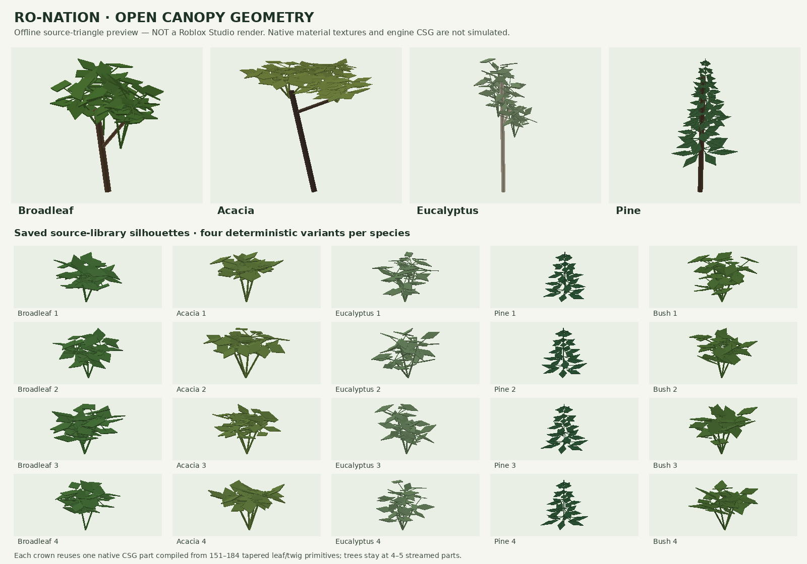

# Highland environment overhaul

## What highland-3 changes

The environment update now includes a saved-terrain upgrade, new reusable foliage geometry,
more roadside and bridge detail, and refinements to the existing lighting/weather system.
The implementation covers the original prompt's terrain, vegetation, infrastructure,
lighting, weather, day/night and performance areas. Its final rendered appearance and
20–25-player performance still need Roblox Studio and device acceptance; offline tests
cannot establish those results.

| Area | Implemented behavior | Verification still needed |
| --- | --- | --- |
| Terrain | Coherent ridges and folds up to 16 studs, blended around existing anchors; soil/grass/mud patches; riverbank, sediment and rural drainage profiles | Inspect the saved terrain after the conservative patch, especially columns deliberately preserved |
| Trees and undergrowth | Four tree species and shrubs use pointed leaf sprays with connected twigs; four reusable crown variants per species; varied dimensions, forks and spacing | Engine CSG compilation, saved-place persistence, canopy appearance and shadows |
| Roads and junctions | Existing alignment/grades retained; asphalt variation, gravel shoulders, drainage, readable signs and markings; lined downhill outlets, rounded guardrail ends and utility insulators | Driving, collision and visual integration on every junction/approach |
| Bridges and rivers | Existing crossings retained; supports, foundations, barriers, wingwalls, grounded riprap, bank vegetation and restrained water settings | All five bridges, water reflections and support-to-bank contact in Studio |
| Lighting | Existing natural lighting retained; humidity-sensitive dawn valley haze and smooth altitude changes added | Clear/overcast comparisons at morning, midday, sunset and night |
| Weather and day/night | Five gradual states, seasonal weighting, local rain, lightning, synchronized visual clock and marked night lamps; better shelter handling after camera changes/teleports | Two-client synchronization, indoor rain, streaming and device behavior |
| Audio | Original rain/thunder WAV sources and playback hooks exist | Owner must upload the sounds and grant experience permissions; blank IDs remain silent |
| Performance | Cached foliage templates, small streamed models, bounded local rain, quality scaling and distance-limited streetlights | Lower-end hardware and an actual 20–25-player session |

City positions, the road network, place heights, fields, property definitions, spawn and
German-influenced signs remain anchored to `MapLayout`. Existing sign instances are retained
by the upgrade, including manual text and position edits. The available project lore is
`Lore` and the Discord Kagundi Encyclopedia; seasonal tuning adds no new canon.

## Apply to an existing place

Use the repository's existing default branch, `claude/project-thread-5krwdh`.
In GitHub Desktop select that branch, then **Fetch origin**
and **Pull origin**. Keep using the local checkout that runs `rojo serve`.

1. Save a backup of the current place with **File > Save to File As…**.
2. Restart `rojo serve`, connect the Studio Rojo plugin and let the new modules sync.
3. Stop Play. If `BuildMap` was already required in the command bar, save and restart Studio
   after syncing, then reconnect Rojo; its module return value can remain cached.
4. In the Studio command bar, run:

```lua
require(game.ServerStorage.StudioTools.BuildMap).upgradeEnvironment()
```

This is the command for the complete saved-map update. It prepares the reusable canopies,
patches matching generated terrain, then refreshes roads, bridges, roadside details,
vegetation and the environment preset. The first canopy preparation and terrain scan can
take time; follow the progress in **Output**. Save the place when it finishes, then use Play
to see weather, time and lamps.

For a terrain scan without terrain, canopy or geometry writes:

```lua
local report = require(game.ServerStorage.StudioTools.BuildMap).upgradeEnvironment({ DryRun = true })
print(report)
```

The report distinguishes eligible, changed, already-current, unchanged and preserved
columns, plus water mismatches. A dry run reports candidates without committing changes.
After an actual run, `OriginalColumns` counts written columns recognized only as the
pre-overhaul generator. Output and `Workspace.Map` attributes expose the `highland-3`
revision, changed/preserved terrain counts and skipped lighting components.

### What the updater preserves

The terrain patch reads 4-stud voxels in 64-stud chunks. A candidate column must match either
the original pre-overhaul terrain model or the previous environment model before it is
changed. It also recognizes already-updated columns, so a later run can resume. Sculpting,
material paint, changed water, missing/extra ground and unknown terrain are conservatively
preserved when the column differs from these known baselines. Occupancy comparison allows
the small quantization error of stored voxels.

Anchored, collidable custom construction outside generated folders protects its projected
footprint plus a margin from terrain changes and vegetation placement. The replacement
vegetation samples the actual saved terrain, including columns the patch preserved, rather
than assuming all new terrain heights were applied. Missing ground and open water are
skipped for trees/shrubs; river rocks may sample the underwater bed.

The updater does not call `Terrain:Clear()`. Places, properties, countryside, spawn and custom
objects outside replaced generated folders are retained. The selected generated folders are
replaceable output: keep hand-built objects outside them. A selected folder without the
`GeneratedBy = "BuildMap"` marker stops the full upgrade before terrain writes.

Canopy preparation completes before terrain writes begin. New environment folders are
staged before replacing the old geometry; a staging failure retains the previous geometry.
**Terrain writes are incremental, not an atomic transaction.** An interrupted scan/write can
leave earlier chunks upgraded; Output reports the error and a rerun recognizes current
columns. The tool attempts a Studio undo recording, but the saved place backup remains the
reliable recovery method. Do not infer a full terrain rollback from a geometry failure.

### Other entry points and stale modules

For a geometry/lighting refresh that leaves terrain voxels untouched:

```lua
require(game.ServerStorage.StudioTools.BuildMap).refreshEnvironment()
```

It samples the saved ground for vegetation. Its optional `Roads`, `RoadDetails` and
`Vegetation` flags select generated groups; it does not apply the terrain upgrade.

`BuildMap.run()` remains the initial full-map builder. By default it **clears all terrain**
and rebuilds generated map groups. `run({ Terrain = false })` replaces generated geometry
but retains terrain. Neither is required to apply this saved-map update.

If the command fails with `CommandBar:1: attempt to call a nil value`, inspect the new entry
point without altering the map:

```lua
local module = game.ServerStorage.StudioTools.BuildMap
print("Current source:", string.find(module.Source, "function BuildMap.upgradeEnvironment", 1, true) ~= nil)
print("Loaded function:", typeof(require(module).upgradeEnvironment))
```

Expected: `true` / `function`. `false` / `nil` means the new source did not reach this place;
check the local files and Rojo connection. `true` / `nil` indicates a stale module cache:
save, restart Studio and reconnect Rojo. Do not use a destructive full rebuild as a fix.

## Landscape, foliage and infrastructure controls

`src/studio/Map/LandscapeConfig.luau` controls the new terrain relief. It uses coherent
domain-warped ridges/folds, with protection and smooth fades around roads, places, fields,
river/lake basins, the map edge and low terrain. Existing `Land`/`RoadNetwork` anchors stay
unchanged. `Heightfield` retains the previous generator functions, while `OriginalSurface`
is an immutable migration baseline for the original map; changing that baseline would
prevent reliable recognition of older saved terrain.

`CanopyLibrary` compiles **20 native CSG templates**: four variants each of broadleaf,
acacia, eucalyptus, pine and bush. Connected twigs and tapered leaf sprays replace the old
spherical foliage masses. Native `LeafyGrass` and `Wood` materials supply surface detail;
there are no uploaded meshes, leaf transparency textures, bark maps or asset IDs. The
templates are cached in `ServerStorage.RoNationCanopyLibrary` and cloned for the map.
Compilation occurs in edit mode, never per tree during Play. A failed CSG preparation
reports an error rather than silently reverting to spherical crowns. Save the generated
library with the place.

The following preview is generated from the exact source triangles and tree transforms:



**This is not a Roblox Studio render.** The offline preview does not simulate the engine's
CSG solver, native material textures, lighting or shadows. Regenerate it with
`python3 tools/preview-canopies.py` (requires the Luau CLI, NumPy and Pillow).

Vegetation uses regional biome density, terrain suitability and road/water clearance.
Trees remain small atomic streamed models. Lower `MapLayout.Vegetation.Density` for a lighter
saved map and rerun the geometry refresh. The new infrastructure adds grounded wingwall
riprap, positive-fall drainage outlets, rounded guardrail terminals and cable-top ceramic
insulators; the existing road/sign dimensions and network are retained.

## Runtime and tuning

`src/shared/Config/Environment.luau` is the central runtime configuration. The existing
natural daylight, sunset and night setup remains; a light humid valley veil now clears
during the morning. A 60-minute visual day begins at 09:30 and is unrelated to the economy
bot's Europe/Berlin economic day.

Clear, PartlyCloudy, Overcast, Rain and Thunderstorm blend over 75 seconds. Automatic weather
initially holds for 6–11 minutes. Neighbouring-state progression and seasonal weights make
March–May and September–December wetter. Altitude adds modest haze/rain variation; no snow
or desert weather is introduced. Clients compose weather with time, so an overcast sunset
does not suddenly become clear. Clouds and terrain grass use Roblox `GlobalWind`.

Animated terrain grass needs **Workspace > Terrain > Decoration** enabled in Studio's
Properties window, then saved with the place. Roblox marks this property
[Not Scriptable](https://create.roblox.com/docs/reference/engine/classes/Terrain#Decoration);
neither the map module nor Rojo live sync can switch it on. Earlier module versions logged
"Could not switch on animated grass" after attempting that forbidden write. The corrected
module retains the saved setting and no longer claims to enable grass. This message does
not indicate a failed map upgrade, and enabling the checkbox needs no terrain rebuild.

The server schedules weather/lightning and publishes timestamped state. Clients render
lighting, clouds, local rain, optional audio and nearby night lamps. Rain probes remain
tied to sampled world positions; a large camera move immediately rechecks shelter and a
camera replacement clears stale rain. Altitude and sound volume use time-based smoothing.

For immediate Studio Play tests, use the **server** command bar:

```lua
local environment = require(game.ServerScriptService.Server.Services.EnvironmentService)
environment.setWeather("Thunderstorm") -- Clear, PartlyCloudy, Overcast, Rain, Thunderstorm
environment.setClockTime(18.5) -- cycle continues from this hour
```

Use the **client** command bar to set effect quality (0 minimal, 1 low, 2 medium, 3 high):

```lua
game.Players.LocalPlayer:SetAttribute("EnvironmentQuality", 1)
```

Remove that attribute to follow Roblox's saved graphics quality. Low quality reduces rain
amount/probe frequency. Rain is capped at 64 reused non-colliding parts; streetlight range
is capped at 260 studs. There is no runtime terrain/foliage rebuild or per-frame server
landscape work. Client attributes `EnvironmentClientReady`, `EnvironmentClientStatus` and
`EnvironmentAudioConfigured` help diagnose whether the runtime is initialized.

Original generated WAV files and upload instructions are in
[`assets/audio/README.md`](../../assets/audio/README.md). `Effects.Audio.Rain` and `Thunder`
are deliberately blank until the owner uploads them and grants experience permissions.
Rain and thunder therefore remain silent by default; uploading the files is still required
to satisfy audible weather acceptance.

The edit-mode lighting migration recognizes the exact original Atmosphere/Bloom/SunRays/
ColorCorrection preset, adopts it or removes a proven old duplicate, then applies the
natural setup. Altered custom effects are preserved and reported. Custom Atmosphere/Clouds
take precedence, so review any skipped components in Output before comparing appearance.

## Validation and remaining acceptance

Run the offline suites and build:

```sh
python3 tests/map/test_all.py
python3 tests/environment/run.py
rojo build default.project.json -o environment.rbxlx
```

The map suite checks layout/grades, river/lake samples, the 16 economy property definitions,
relief protection, migration/voxel classification, reusable canopy geometry, infrastructure,
saved-ground placement and the real builder entry points against a Roblox API stand-in.
The migration checks cover dry runs, repeated application, original/previous baselines,
custom terrain, water mismatch and interrupted writes. Environment tests exercise the
clock, climate selection, blending, service lifecycle, actual local rain effect logic and
saved lighting migration. Compilation, formatting and a Rojo build check source packaging;
none run the Roblox engine.

Executed for this iteration:

| Check | Result |
| --- | --- |
| Full map suite | 1,405 Luau checks passed; all 16 economy property definitions match |
| Historical terrain baseline | Exact independent comparison at 80,731 surface points and 565,117 material decisions; regression samples retained in the suite |
| Environment suite | 62 checks passed: 21 model, 12 service, 9 local effects and 20 presentation |
| Existing economy/Discord suite | 90 tests passed |
| Source/package checks | All 60 Luau source files compiled; StyLua, whitespace and Rojo build passed |
| Mock-generated geometry | 38,520 parts under `Workspace.Map`, below the 45,000-part budget; vegetation uses 30,529 parts for 5,214 trees, 4,119 shrubs and 2,696 rocks |

The geometry counts come from the offline builder and its CSG stand-in. They measure saved
instance budgets, not engine triangle cost, frame rate or CSG visual quality.

Roblox Studio, a saved current place and the prompt's reference screenshots were unavailable
in this environment. Selene could not obtain its Roblox API standard library. Full Roblox
API/type analysis, native CSG execution, rendered comparisons, physics, actual audio,
streaming under movement and device/player-load profiling remain unverified.

Before release:

- Run the upgrade on a backup; compare changed/preserved terrain counters and inspect city,
  field, road, lake and river boundaries. Confirm custom sculpting/buildings remain intact.
- Save and reopen the place; confirm cached CSG canopies persist and all four tree species
  read well at near and far distances under clear/overcast lighting.
- Drive all five bridges and junctions; inspect collision, rails, supports and drainage.
- Enter buildings in rain, teleport/respawn and change cameras; check for indoor streaks.
- Exercise every weather state at dawn, midday, sunset and midnight; verify gradual
  transitions, sheltered rain/audio, lightning/thunder delay and lamps.
- Join an active storm from two clients, including after streaming; compare sky and time.
- Profile low/high graphics on lower-end hardware and in a 20–25-player session.
- Verify account linking, properties, signs and other existing gameplay in Studio.

## Changed files

These are the principal files for the highland-3 iteration; the existing environment runtime,
natural preset, river details and audio sources from the earlier update remain in use.

| Area | Files |
| --- | --- |
| Saved-map entry points and protection | `src/studio/BuildMap.luau`, `src/studio/Map/ExistingTerrain.luau`, `src/studio/Map/Builders/TerrainUpgrade.luau` |
| Terrain relief and migration baseline | `src/studio/Map/Heightfield.luau`, `src/studio/Map/LandscapeConfig.luau`, `src/studio/Map/OriginalSurface.luau` |
| Reusable foliage and placement | `src/studio/Map/Builders/CanopyLibrary.luau`, `src/studio/Map/Builders/Vegetation.luau`, `src/studio/Map/Vegetation.luau` |
| Bridge and roadside details | `src/studio/Map/Builders/Bridges.luau`, `src/studio/Map/Builders/RoadDetails.luau` |
| Lighting/weather refinements | `src/shared/Config/Environment.luau`, `src/shared/Environment/Model.luau`, `src/client/Controllers/EnvironmentController.luau`, `src/client/Controllers/WeatherEffects.luau` |
| Map regressions | `tests/map/roblox-mock.luau`, `tests/map/test_all.py`, `tests/map/builders.spec.luau`, `tests/map/vegetation-builders.spec.luau`, `tests/map/canopy.spec.luau`, `tests/map/highland-relief.spec.luau`, `tests/map/original-parity.spec.luau`, `tests/map/terrain-upgrade.spec.luau`, `tests/map/infrastructure-v3.spec.luau`, `tests/map/upgrade-entry.spec.luau` |
| Weather regressions | `tests/environment/run.py`, `tests/environment/model.spec.luau`, `tests/environment/effects.spec.luau` |
| Source-geometry preview | `tests/map/preview-canopies.luau`, `tools/preview-canopies.py`, `docs/game/canopy-geometry-preview.png` |
| Instructions | `README.md`, this document |
