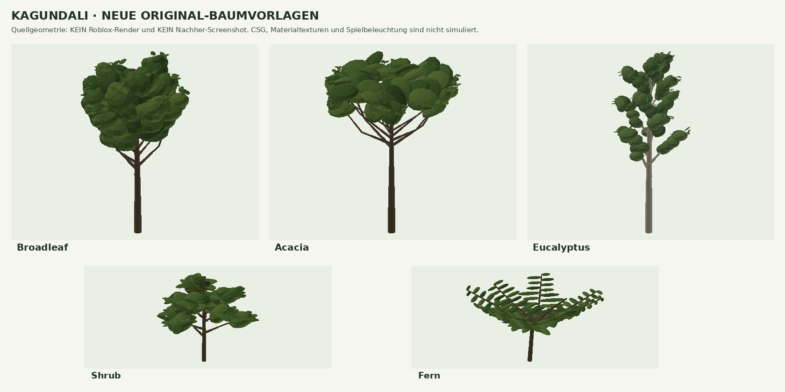

# Kagundali R3/N5: first visual benchmark area

> **Current state: junction-3.** Three new screenshots from Justin confirmed that junction-1
> was applied, but showed a fault in the leaf geometry. Diagnosis, fixes and the update
> command: [Studio screenshot fixes](08-kagundali-screenshot-fixes.md). The numbers and
> implementation notes below document the first state.

**State: `kagundali-junction-1`, lighting `neutral-highland-1`.** The code and the offline
test setup are in place. The visual acceptance in Roblox Studio is open: the build
environment has neither Studio nor a renderer for the place. A passing test result does not
confirm a visible rebuild in your saved place. The rest of the map stays on the
`highland-4` baseline.

## Why the earlier changes were not enough

- **The old tree geometry itself was the problem.** The five screenshots at the time showed
  large, flat leaf plates on simple trunks. The earlier library really does produce such
  plates; bigger crowns and more trees barely change that construction. The new area uses
  its own library with branching wood, small curved leaves and overlapping,
  three-dimensional crown clusters.
- **Rojo transfers code but does not rebuild the saved world.** `default.project.json`
  contains no generated `Workspace.Map` and runs no builder. The Studio tools have to be
  run in edit mode and the place saved afterwards. This repository has no separate
  production/development map system. Which local checkout your Studio had loaded cannot be
  determined from here, so a sync error is not a proven explanation for your screenshots.
- **`refreshEnvironment()` had a deliberately limited scope.** It replaces generated
  environment geometry but keeps terrain, signs and town placeholders. The full terrain
  patch protects roads, places and unknown or hand-edited terrain columns. So the message
  "Environment refreshed" is not proof of new ground shapes.
- **Lighting is recalculated during Play.** The client applies `Environment.Model`
  continuously. Changing only the saved Lighting properties is not enough. The Rojo preset
  and the weather model now share the same, more neutral starting point.
- **The module cache can return outdated functions.** The new direct entry point
  `UpgradeKagundali` avoids the missing method of a `BuildMap` table that was already
  loaded. Shared modules that were already loaded still need a Studio restart; a version
  check stops the update when it detects an old lighting model.

## What the area now builds

The existing R3 meets the N5 at **X 453, Y 56, Z 3299**. The edited window covers
X 64–832 and Z 2944–3648. Road axes, road heights, water, town positions and property
definitions are kept.

| Part | Implementation |
| --- | --- |
| Trees | Three kinds: broadleaf, acacia, eucalyptus; three variants each, different sizes and rotations; curved, tapering trunks with connected branches |
| Undergrowth | Own bush and fern templates, forest clusters, a clear view at the junction and distance from power lines; rocks partly sunk into the ground |
| Terrain | Bounded, softly fading ground folds, hollows and embankments; continuous grass areas, mud along the drainage and rock on steep cuts; a paved workshop yard |
| Road | Extra gravel shoulders, a visible U-shaped drain, a turn arrow on the R3 approach and a gravel driveway to the workshop yard; the existing asphalt variation, markings and guard rails stay |
| Signs | Existing yellow direction signs keep their text, arrows and board positions; posts move behind the readable face, with concrete feet and braces on the back |
| Buildings | Small transport workshop with a service bay, office front, sloped metal roof, roof seams, rainwater tank, transport crates, a physical sign and a night lamp; the floating Kagundali development name is hidden |
| Lighting | Less blue haze, more neutral scattering, lower daytime ambient light and sharper shadows; one shared preset for edit mode and runtime |
| Weather | Existing transitions, clouds, rain strengths, thunderstorms, day/night and quality-dependent effects stay connected to the updated lighting model |

The deterministic test setup on generated ground builds **64 trees, 49 bushes, 47 ferns,
23 rocks and 919 BaseParts in total** in the new area. The extra braces on the existing
signs are counted separately. On saved ground that differs, objects can be skipped. With
fewer than 20 suitable tree positions the replacement stops; on unsuitable workshop ground
the report says `Workshop: false`. These cases need a look on site.

The 15 plant templates are prepared once as 60 native CSG parts in total and saved in
`ServerStorage.RoNationJunctionTrees`. A tree uses four visible CSG parts and a narrow
trunk collider; a bush or fern uses four non-colliding parts each. Models stream
atomically. The regional limit is 1,600 BaseParts. That is an instance limit, **not proof
of a GPU, triangle or multiplayer budget**. Only original source shapes and Roblox
materials are used, no invented asset IDs.

## Apply the update to your existing place

1. In GitHub Desktop switch to **`claude/project-thread-5krwdh`** and run **Fetch origin** /
   **Pull origin**. Use the local folder that `rojo serve` runs from.
2. Back up the place with **File > Save to File As…**. Stop Play, connect Rojo and let the
   new modules sync. Then save, restart Studio and reconnect Rojo, so that modules that were
   already loaded do not stay cached.
3. In Studio open **View (Ansicht) > Command Bar (Befehlsleiste)** and run:

```lua
require(game.ServerStorage.StudioTools.UpgradeKagundali)()
```

The first native CSG preparation and the local terrain check can take a while. Output then
shows `kagundali-junction-1` with tree, bush and fern counts, the part budget and the
workshop status. The Studio camera jumps to the R3/N5 junction. A full `BuildMap.run()`
rebuild is not needed.

4. In the **Explorer** (**View > Explorer**) select **Workspace > Terrain** and tick
   `Decoration` in **Properties**. Only the `Grass` material shows Roblox's animated grass.
   The code does not try to read or set this locked property.
5. Check the saved state:

```lua
require(game.ServerStorage.StudioTools.CheckEnvironment)()
```

The check counts the new tree models that are really present and checks the regional
terrain and lighting revisions in addition to the earlier global checks. A `FIX` line for
other areas or for missing audio IDs does not automatically mean the junction failed. Read
each line in Output.

6. Save, then press Play. Look at the area at street level too and check that the lighting
   stays consistent after the start. Save again if you changed settings in edit mode.

Optional: count only the terrain changes, without changing assets, geometry or the camera:

```lua
require(game.ServerStorage.StudioTools.UpgradeKagundali)({ DryRun = true })
```

The patch writes only recognised generated terrain columns inside the window. Unknown,
painted or protected columns are kept. The regional migration recognises `highland-4` in
particular; for older or unknown states read the recognition counters and, if needed, run
the documented [`highland-4` upgrade path](06-environment-overhaul.md#apply-to-an-existing-place)
first. **Terrain is written in sections:** a later error can leave sections that were
already changed. New tree templates are prepared before any terrain change, and new
geometry is built completely before the swap. A second run recognises columns that are
already updated and replaces its own area without duplicates.

`BuildMap.run()` and `BuildMap.upgradeEnvironment()` include the new area. A later
`refreshEnvironment()` rebuilds a junction that was already applied with the new templates
instead of bringing the old tree shapes back there. Keep your own hand-made work outside
the generated folders; generated folders can be replaced.

## Before/after and acceptance

**BEFORE:** the five screenshots delivered last, especially `Ro-Nation_neuer_Screenshot.jpg`
(N5/R3 direction sign), `Ro-Nation_2026-10-27_223933.jpg` (leaf plates), and `224001`,
`224005` and `224100`. They were used to document the problems, not as the target style.

**AFTER the first state: delivered by Justin since.** The three shots `083507`, `083519`
and `083533` from 28 October show the workshop, grass and new trees, but also ball-shaped
crowns and road markings that cannot be seen. The
[review and fix](08-kagundali-screenshot-fixes.md) documents these findings. There is no
Studio after-image of junction-2 or later yet; Claude and Codex still have no Studio
access.



This preview is generated straight from the plant templates with
`tools/preview-junction-trees.py`. It helped to correct crowns that were too open and the
leaf distribution. It does not show Roblox CSG, material textures, game lighting or
terrain.

For the real acceptance in the same place:

- Take the same R3/N5 view as in the before-image; at street level also look at the small
  leaves, branch joints, tree bases, gravel shoulders and signs.
- Check the workshop and its R3 driveway: no floating foundations or plants, no posts in
  front of the lettering, no road through undergrowth.
- Compare clear midday light with an overcast sky, then morning, evening and night; in Play
  test rain, thunderstorms, lamps, shelters and the weather menu.
- Save and reopen; then run the updater again and check that object counts stay the same
  and nothing is duplicated.
- Check native CSG compilation, triangles, streaming and frame rate on a weaker device, and
  synchronisation and behaviour with several clients.

**The visual milestone stays open until this comparison.** Only after a successful
acceptance should the same design be carried over to the rest of the landscape.

## Files and test limits

Final check on 28 October 2026 (by Codex): full map test suite passed, 86
environment/weather checks and 90 bot tests passed. All 67 Luau source files compile, the
18 changed Luau files pass StyLua and the Rojo build succeeds. The 13 matching lighting
values of the saved preset agree with the initial runtime model. The full offline build
contains 39,361 BaseParts under `Workspace.Map`; this number describes the whole map, not
the regional increase and not the number of parts rendered at the same time.

| Files | Responsibility |
| --- | --- |
| `src/studio/UpgradeKagundali.luau`, `BuildMap.luau` | Direct command, camera focus, connection to the existing builders |
| `src/studio/Map/JunctionLandscape.luau`, `KagundaliUpdate.luau` | Local ground shapes, conservative migration, staged geometry swap and revisions |
| `src/studio/Map/Builders/JunctionTrees.luau`, `Kagundali.luau` | Original plants, placement, shoulders, drainage, direction signs and workshop |
| `src/shared/Environment/Model.luau`, `Presentation.luau`, `src/shared/Config/Environment.luau`, `default.project.json` | Runtime lighting, weather link and the identical saved starting preset |
| `src/studio/CheckEnvironment.luau` | Check of the regional geometry and revisions that are really saved |
| `tests/map/`, `tests/environment/model.spec.luau` | Terrain and builder integration, reruns, failure cases, model lighting and existing regressions |
| `tools/preview-junction-trees.py`, `tests/map/preview-junction.luau` | Repeatable preview of the source geometry |

The automated tests run the real builders against a strict Roblox object model, but
simulate native CSG operations and terrain raycasts. The terrain migration is also checked
with real 4-stud voxel arrays from the earlier generator: DryRun writes nothing,
painted/protected columns are kept, and a second patch does not rewrite columns that are
already current. Road heights, water and terrain outside the window are checked to be
unchanged.

Still open: the real visual check, native CSG execution, driving and collision tests,
save/reload and performance with 20–25 players. The included rain/thunder WAVs still have
to be uploaded to Roblox and permitted for the experience; blank IDs stay silent. The other
town placeholders, farmland, mountains and remaining roads are not claimed to be rebuilt in
this step.

**Next area after acceptance:** the R3 westwards towards Kagundali, with the transition from
the transport workshop to the mining/industrial access road.
