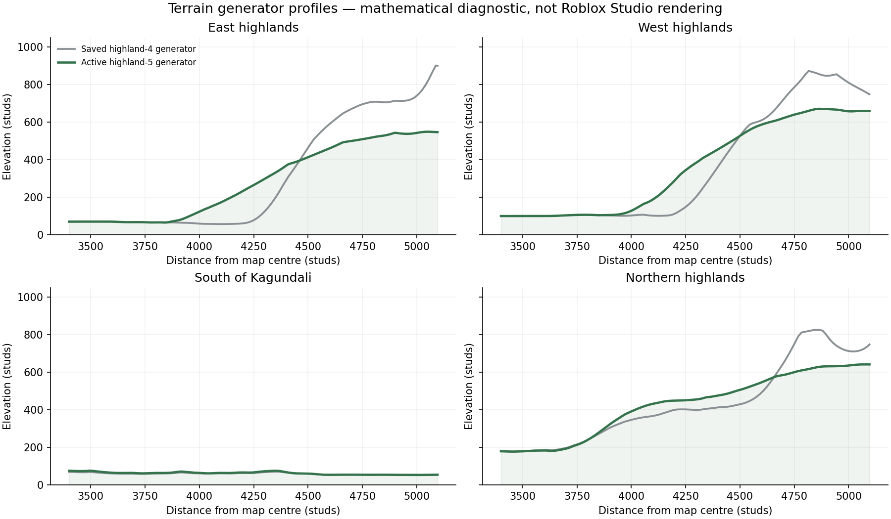

# Terrain and infrastructure realism rework

Code revisions: **highland-5**, **kagundali-junction-6**, **neutral-highland-2**.

## Reference and active systems

All six supplied screenshots were inspected before implementation. Their filenames end in
235220 (woodland interior), 235232 (junction from above), 235241 (highway/workshop and mountain
foot), 235249 (N5 direction signs and mountain ring), 235255 (junction overview), and 235311
(woodland edge). They show the current map, not a target or an after-state.

The active path is `BuildMap.upgradeEnvironment()` → saved terrain migration → shared road and
vegetation builders → `KagundaliUpdate.apply()`. `default.project.json` synchronizes these modules
to `ServerStorage.StudioTools`; synchronization alone does not regenerate saved geometry. The
regional updater previously repainted almost all natural ground as `Grass` and rebuilt the
workshop. Global trees previously ignored the saved Creator Store mesh library.

The largest visual causes were a roughly 700-stud mountain rise with fine ridged noise and
altitude-driven exposed rock, universal native grass beneath the regional trees, repeating
concrete channels, and strong canopy shadows. These have been changed in the active generators.

## Implemented changes

- **Mountains:** broadened, independently varying boundary ridges and foothills, fewer sharp
  peaks, modest drainage grooves, and wider transitions around protected land. Rock exposure now
  follows slope and coherent geology; elevation alone no longer paints an entire summit grey.
  Mountain boundaries, passes and the existing geographical layout remain in place. Existing
  road profiles are calculated from the immutable original land model.
- **Countryside and ground cover:** stronger connected relief outside protected areas, low
  cover mixed with taller meadow patches, exposed soil on eroding slopes, and shade-dependent
  woodland litter. The same habitat selector serves the global map and regional update.
  Authored crop rows and field edges remain intact.
- **Trees and forests:** the global builder now reuses compatible trees, shrubs, ferns and
  stones from the saved official Roblox library. Species without matching imported templates
  retain their existing native assets. Roots are embedded more deeply using downhill ground
  probes. Connected stands interrupt the fine placement grid without increasing density.
  A bounded amount of low plants, small sticks and litter follows suitable ground near trees.
  Regional tree positions no longer follow evenly spaced spiral rings.
- **Roads:** neutral asphalt with coherent age variation, small shoulder-width variation and
  saved-ground support checks, thinner muted markings, approach lines ending before stop bars,
  and physical reflector panels. The N5 destinations and road connections are unchanged.
  Long rural concrete channels have been replaced by existing earthen swales; concrete is
  considered only near the workshop crossing or sufficiently steep drainage. The existing
  workshop driveway and crossing survive with the building.
- **Utility infrastructure:** slimmer, taller wooden poles and wire sag constrained by terrain
  clearance. Unsupported spans are omitted instead of passing through protected construction.
- **Outdoor lighting:** increased daylight canopy fill, gentler contrast and less persistent
  haze, shared by the Studio starting preset and runtime weather/day-night model. Building
  fixtures, interiors and architectural materials were not edited.

## Preservation and migration

No changes were made to `src/studio/Gundiville/`, `src/studio/Architecture/`,
`src/server/Main.server.luau`, `tests/map/roblox-mock.luau`, `tests/map/gundiville.spec.luau`
or `tests/map/run.py`. The environment upgrade never invokes `BuildGundiville`.

Original, highland-3, highland-4 and regional saved generators remain available for exact
voxel-column matching. Additional baselines must match occupancy and material across the
whole column. Manual sculpting, painting, changed water and unknown columns are retained.
Construction footprints are protected, including the saved workshop inside its generated
folder. The regional updater transfers that exact building instance after successful staging;
it does not rebuild its walls, roof, materials or fixtures, and does not add a missing workshop.

Terrain writes are incremental. Save a place backup first. If interrupted, earlier chunks may
already have changed; the migration recognizes current columns on rerun. A revision marker
does not establish that every column was eligible or that the appearance is accepted.

## Apply to the existing place

1. Pull the updated project, stop Play and back up the place. Sync Rojo, save, restart Studio
   and reconnect Rojo to clear old `require()` results. The lighting revision guard rejects a
   cached old model in the regional updater.
2. Optionally inspect eligibility without writes:

   ```lua
   require(game.ServerStorage.StudioTools.BuildMap).upgradeEnvironment({ DryRun = true })
   ```

3. Apply the **map-wide** update in the edit-mode Command Bar:

   ```lua
   require(game.ServerStorage.StudioTools.BuildMap).upgradeEnvironment()
   ```

   This also updates the R3/N5 benchmark. `UpgradeKagundali()` alone affects that region only.
   Use the saved official Forest Pack / City Props Pack library already present in the place;
   there are no new asset IDs, paid models or runtime asset downloads in this rework.

4. Select **Workspace → Terrain → Properties**. Set **GrassLength = 0.25**, keep
   **Decoration** enabled, and save the place. The Roblox API marks both properties
   `NotScriptable`; neither a Lua assignment nor a Rojo property write can set them. The new
   material selector reduces where tall native grass grows, but cannot resize its blade mesh.
5. Inspect the saved result:

   ```lua
   require(game.ServerStorage.StudioTools.CheckEnvironment)()
   ```

Do not use `BuildMap.run()` on this existing place: it is the initial destructive full-map
builder. Use the conservative upgrade above to retain construction and custom terrain.

## Verification and remaining limitations

Relevant changed implementation files:

| System | Files |
| --- | --- |
| Terrain and habitat | `src/studio/Map/Land.luau`, `Heightfield.luau`, new `GroundCover.luau` |
| Saved terrain migration | `src/studio/Map/Builders/TerrainUpgrade.luau`, `src/studio/Map/ExistingTerrain.luau` |
| Vegetation and imported assets | `src/studio/Map/Vegetation.luau`, `src/studio/Map/Builders/Vegetation.luau`, `src/studio/Map/CreatorAssets.luau` |
| Regional regeneration | `src/studio/Map/JunctionLandscape.luau`, `src/studio/Map/KagundaliUpdate.luau`, `src/studio/Map/Builders/Kagundali.luau` |
| Roads and utilities | `src/studio/Map/RoadDetails.luau`, `src/studio/Map/Builders/Roads.luau`, `src/studio/Map/Builders/RoadDetails.luau` |
| Lighting | `src/shared/Environment/Model.luau`, `Presentation.luau`, `src/studio/Map/Builders/Environment.luau`, `default.project.json` |
| Active entry and inspection | `src/studio/BuildMap.luau`, `src/studio/CheckEnvironment.luau` |
| Diagnostics and documentation | `tests/map/realism.spec.luau`, existing migration/asset/entry/material tests, `tests/environment/model.spec.luau`, `tools/preview-highland-relief.py`, this document and `README.md` |

The offline checks exercise the actual Luau generators/builders with the existing test backend.
They cover road and bridge elevations, complete government-building footprints, fields and
water preservation, map-wide mountain/ground-cover coverage, concrete reduction, separation of
stop bars, root placement, script-free imported assets, the actual global asset selection,
unchanged workshop instances, staged failure handling, migration of occupied painted voxels,
and idempotent upgrades. Historical terrain tests continue to guard the frozen highland-3/4
models; `realism.spec.luau` checks the new active surface separately.

On the fixed 64-stud map sampling grid, steep boundary samples fall from 4,081 to 752 and
rock-material samples from 5,487 to 1,054; 7,102 mountain samples change by over 30 studs.
Tall native grass is absent at the 3,242 sampled unprotected woodland points and present
at 1,438 of 6,156 sampled gentle meadow points. The regional scene considers 2 concrete
channel paths instead of 75, and retains the existing workshop crossing. These are generator
measurements, not a rendered-image comparison or a measurement of the live saved place.

All 93 source files compile with the Luau CLI and the Rojo project builds. Map and weather
checks run outside Studio. A standalone CLI typecheck of the pure map modules emits the same
14 pre-existing `table.create` inference diagnostics on the base revision and this revision;
there are no new diagnostics in that comparison. This is not a claim of a clean project-wide
Studio/LSP typecheck.

The generator profile figure below is a reproducible mathematical diagnostic. It is **not** a
Roblox screenshot or visual acceptance result. Run `tools/preview-highland-relief.py` to recreate it.



Roblox Studio and a live renderer are unavailable in this environment. The working Open Cloud
key does not provide an interactive Studio viewport. No after-screenshots or 20–25-player
performance measurements are claimed. The native grass-length change is a required manual
Studio step. The broadleaf pack's actual mesh silhouettes and appearance maps must still be
judged in the saved place; missing species use the existing native fallbacks.

Compare these six views before accepting the result: N5/R3 at road height and from above,
the long highway past the workshop, the mountain foot and skyline, the forest interior, the
forest edge, and open countryside in the other regions. Check noon in Clear/PartlyCloudy first,
then Overcast, rain and nighttime. Verify driveway/bridge collision, cable clearance and
streaming while moving. Profile a populated server and lower-end client before claiming the
20–25-player performance target.
