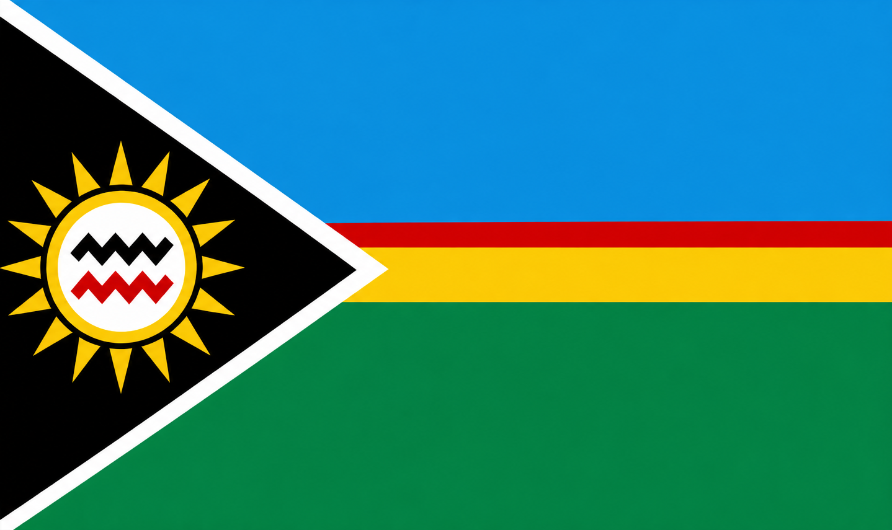
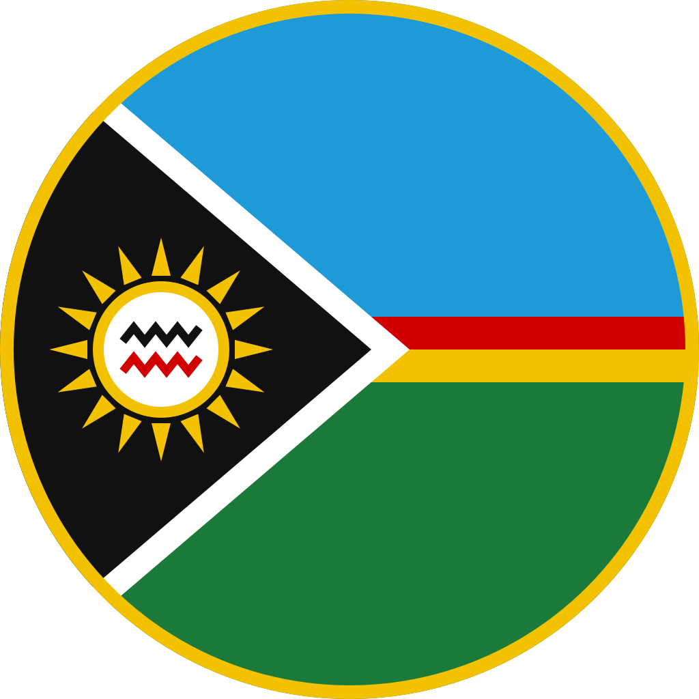

# Democratic Republic of Kagundi: Lore Bible

*Last updated: 26 October 2026*

**Project:** Ro-Nation\
**Document status:** Consolidated Worldbuilding Reference, revision 2\
**Setting:** Fictional African Nation\
**Roleplay format:** Government Roleplay (Government RP)

**New in revision 2:** everything from revision 1 is kept. The following was added or settled:

- History: the German Regency of 1915–1919, the First Republic of 1960–1982, the causes and course of the 1982 Revolution, and the revolutionary state after 1983.
- Ideology: after 1982, Kagundi's politics follow Muammar Gaddafi's Third Universal Theory, adapted to Kagundi (new section 5.6).
- Indigenous language and culture: Kagundisch, a German-based creole, plus names, religion, food, music, and holidays (new section 4A).
- Leader of the Revolution: confirmed as a title, comparable to Gaddafi's title in Libya. The current Leader is Dr. Justin Wachmann, played by the Owner.
- Justice: mayors judge all ordinary cases in the first instance; prosecutors keep the justice-degree requirement; appeals must be filed within 72 hours.
- Flag and emblem: the official flag and round emblem, with a description of the flag (section 1).

---

## 1. National Profile

The **Democratic Republic of Kagundi**, commonly known as Kagundi, is a fictional African nation with a history shaped by German and French colonial influence, negotiated independence, and a military-backed revolution.

Located within a fictional alternate history of the territory corresponding geographically to modern Rwanda, Kagundi is a landlocked country characterized by mountains, forests, highlands, valleys, and agricultural regions.

The country combines a German-influenced administrative and institutional tradition with a predominantly indigenous population and a centralized revolutionary state.

### Basic National Facts

| Attribute | Description |
| --- | --- |
| Official name | Democratic Republic of Kagundi |
| Common name | Kagundi |
| National currency | Kagundi Dinar (KGD) |
| Official languages | German and English |
| Everyday language | Kagundisch, a German-based creole (not an official language) |
| Capital | Gundiville |
| State organization | Centralized unitary state |
| De jure government | Presidential republic |
| De facto government | Authoritarian presidential dictatorship |
| State ideology | Revolutionary doctrine based on Gaddafi's Third Universal Theory |
| Head of state | Leader of the Revolution (a title), currently Dr. Justin Wachmann |
| Head of government | Secretary-General of the People's Committee |
| Independence | 1960 |
| Revolution | 1982 |
| National day | Revolution Day, 12 May |
| Main trading partner | Germany |
| Other trading partners | European Union and China |
| Principal exports | Gold, diamonds, palladium, timber, tobacco, and beef |
| National insurance provider | AVK — Allgemeine Volksversicherung Kagundi |

Kagundi is an intentionally fictional country. Its geography draws on Rwanda, but its colonial timeline, political institutions, national history, and present-day state are part of the Ro-Nation alternate-history setting.

### Flag and Emblem

The **national flag**, introduced after the 1982 revolution, has a black triangle at the hoist, edged in white. The rest of the flag is divided horizontally into a blue upper band, a narrow red stripe above a yellow stripe, and a green lower band. Inside the triangle, a rayed yellow sun surrounds a white disc with two zigzag lines, black above red.

| Element | Meaning |
| --- | --- |
| Black triangle | The Kagundian people |
| White edge | Peace and unity between Kagundi's communities |
| Yellow sun | The dawn of 12 May 1982 and the revolution |
| Zigzag lines | An Old Gundi pattern for the mountains and rivers of the highlands |
| Blue | The sky over the highlands |
| Red | The blood of the 1917 Kagundali strikers and of the revolution |
| Yellow | Gold and the country's mineral wealth |
| Green | Forests, farmland, and pastures |

The **national emblem** places the flag's design in a circle inside a gold ring. It appears as a seal on government documents, uniforms, vehicles, and public buildings. Out of character, the emblem is also the Ro-Nation logo.

## 2. Geography and National Territory

Kagundi is a landlocked country with a predominantly mountainous and highland landscape. Its terrain includes forested hills, valleys, agricultural areas, and more densely populated urban regions.

The **East District** contains the capital and all major cities in the initial Ro-Nation map.

The national map is designed as a large, connected environment rather than a collection of isolated roleplay locations.

### Main geographical characteristics

- Mountainous terrain and elevated plateaus.
- Forests, valleys, and rolling agricultural land.
- Urban and industrial development concentrated around major transport routes.
- Mining areas and industrial facilities outside the principal commercial centres.
- Tobacco farms and livestock production in rural districts.
- International border crossings connecting Kagundi to regional trade routes.

Because Kagundi has no coastline, international trade depends on air cargo and cross-border transportation. Ground transport is especially important for moving agricultural products, timber, machinery, and industrial goods.

## 3. History of Kagundi

Kagundi's history runs through six eras: the pre-colonial Kagundi Basin, German rule, a short German military regency, the French protectorate, the First Republic, and the revolutionary state since 1982.

| Era | Years | Length |
| --- | --- | ---: |
| German-Kagundi | 1885–1915 | 30 years |
| German Regency | 1915–1919 | 4 years |
| Kagundi Protectorate | 1919–1960 | 41 years |
| First Republic | 1960–1982 | 22 years |
| **Revolutionary State** | **1982–today** | **44 years** |

The German Regency lasted only four years, while the revolutionary state has now lasted 44 years, longer than the 41-year protectorate.

### Before 1885 — The Kagundi Basin

Before colonial rule, the territory consists of indigenous communities and regional political structures. The name *Kagundi* originates from the historical designation of the Kagundi Basin or Territory of Kagundi.

The prefix “Ka-” is treated as an established element of Kagundi's historical place-naming tradition.

In Old Gundi, the ancestral language of the indigenous population, *Ka-* means “land of” or “place of”. *Kagundi* therefore means “land of the Gundi”, the name most indigenous Kagundians still use for themselves (see section 4A).

### 1885–1915 — German-Kagundi

The territory comes under German colonial rule and is officially known as German-Kagundi. The name Kagundiland also appears in historical records and cartography.

German administration influences the country's institutional development, architecture, infrastructure, commercial activity, and later political elite.

German settlement communities become established during this period.

- The colonial capital is founded as **Gundistadt**, today's Gundiville.
- Lutheran and Catholic missions open the first schools. Schools, plantations, and mines use a simplified German as the common language between Germans and the many local communities. Over the following generations, this contact language becomes Kagundisch.
- Gold mining begins in the hills around today's Kagundali, and tobacco plantations spread across the Oberdueshuson highlands.
- The colonial defence force, the *Schutztruppe*, builds its main garrison at Oberdueshuson. The town has been Kagundi's military centre ever since.

### 1915–1919 — German Dictatorship (the Regency)

Following the end of formal German colonial administration, a German-dominated dictatorship continues to govern Kagundi during a transitional period.

The First World War cuts German-Kagundi off from Berlin: no ships, mail, money, or orders arrive. In 1915 the commander of the Schutztruppe, **Colonel Ernst Kessler**, removes the civilian colonial administration and proclaims himself **Landesverweser** (Regent) of Kagundi. He claims to hold the territory in trust for Germany but governs on his own authority. Kagundians remember these years as the *Verweserzeit*, the Regency.

- **1915:** Kessler declares martial law. German settlers form an armed militia to support the regime.
- **1916:** To pay his troops, Kessler forces indigenous men into labour in the Kagundali gold mines and requisitions cattle and tobacco.
- **1917:** Miners in Kagundali go on strike. The Schutztruppe breaks the strike by force. The **Kagundali Strike** becomes the founding story of Kagundian resistance, and the strikers are honoured as national heroes today.
- **1918:** The war ends in Europe. The regime loses its last claim to legitimacy, and food shortages spread.
- **1919:** In the post-war peace settlement, Germany gives up Kagundi. French troops enter Gundistadt, and Kessler surrenders without a fight and is deported to Europe.

The Regency leaves a lasting precedent: when civilian government fails, the military takes power. The officers of 1982 follow the same pattern, but they justify it in the name of the 1917 strikers, not the German regent.

### 1919–1960 — Kagundi Protectorate

A French colonial administration assumes control of the territory under the designation Kagundi Protectorate.

French influence becomes another significant element of the country's institutional and cultural development. The colonial period contributes to the formation of a population with mixed German and French family backgrounds.

- **1920:** Gundistadt is renamed **Gundiville**.
- **1923:** The French administration founds the *Gendarmerie du Kagundi*, the predecessor of today's Gendarmerie.
- French words enter everyday Kagundisch, for example *mersi* (thanks), *biro* (office), and *schandarm* (gendarme).
- **1950s:** Teachers, trade unionists, and mission-school graduates found the **Kagundi National Union** (Kagundischer Nationalbund), the movement that negotiates independence.

### 1960 — Independence

Kagundi gains independence through negotiations. Following independence, the former colonial power withdraws, leaving the new state to manage its own political institutions, security arrangements, and economic development.

Independence is proclaimed in Gundiville on 22 November 1960. The new state takes the name Democratic Republic of Kagundi. Its first constitution combines a French-style presidency with a German-style civil service.

### 1960–1982 — The First Republic

Kagundi exists as an independent state before the revolutionary political order is established.

The First Republic is democratic on paper, but power stays with a small elite in Gundiville: German- and French-descended families, senior civil servants, and the leadership of the Kagundi National Union. Foreign companies keep most mining concessions, so most of the profit from gold and diamonds leaves the country.

- **1960–1969:** President **Friedrich Kalembe**, leader of the independence movement, governs. His “national unity” policy keeps the colonial civil service and officer corps in place.
- **1964:** The government recruits skilled workers from Argentina and Uruguay, mainly ranch managers, veterinarians, and mining engineers, to modernise cattle farming and the mines. This is the origin of today's Argentinian and Uruguayan communities.
- **1969:** Kalembe dies in office. **Henri Ondaru** wins the 1970 presidential election amid widespread accusations of fraud.
- **1973:** Large palladium deposits are found near Kagundali. Ondaru sells the mining rights to a foreign consortium far below their value.
- **1977:** Army officers leak the palladium contract. The **Concession Scandal** destroys the government's reputation.
- **1979–1981:** Gold and commodity prices fall and the state runs out of money. The old currency, the **Kagundi Franc**, loses much of its value. Soldiers and teachers go unpaid for months.
- **1981:** Miners in Kagundali and tobacco workers around Oberdueshuson strike. Ondaru orders the army to end the strikes by force, and several units refuse.

### 1982 — The Revolution

A military-backed revolution establishes the political order that continues to govern Kagundi in the present era.

The revolution becomes the foundation of the modern state ideology and the institutional position of the Leader of the Revolution.

The modern government derives its legitimacy from the revolutionary transformation of the state, while retaining the formal title of a democratic republic.

On the night of 11 to 12 May 1982, a group of junior and mid-ranking officers calling itself the **Movement of Free Officers** (Bewegung der Freien Offiziere) leaves the Oberdueshuson garrison for Gundiville. They occupy the radio station, the airport, and the presidential palace. President Ondaru flees abroad, and the takeover is almost bloodless.

The officers name four reasons for the revolution: the corruption of the Ondaru government, foreign control of the mines, unpaid wages, and the order to fire on striking workers. Their leader, Major Wachmann, a 29-year-old officer from a German-descended family, announces the revolution on national radio. From that day on, he is known by his title, **Leader of the Revolution**. 12 May is celebrated as Revolution Day.

### 1983–today — The Revolutionary State

- **1982–1983:** A Revolutionary Command Council of the Free Officers governs, then hands formal power to the new system of People's Councils, the General People's Congress, and the People's Committee.
- **1983:** The government adopts a Kagundian version of Muammar Gaddafi's **Third Universal Theory** as its state doctrine (see section 5.6). The Leader visits Tripoli, and Libya sends advisers to help build the people's congress system.
- **1983:** The **Kagundi Dinar** replaces the Kagundi Franc. Its name follows the Libyan dinar, a sign of the new government's closeness to Libya.
- **1983:** The officers who led the revolution form the core of the new **Revolutionary Guard**.
- **1984:** Foreign mining concessions are nationalised and turned into state-majority-owned enterprises. This is the origin of the state's strategic holdings today.
- **Late 1980s:** Despite its revolutionary language, the government signs machinery and trade agreements with West Germany. Germany becomes, and remains, Kagundi's main trading partner.
- **2000s:** Trade with the European Union and China grows.
- **2021:** The founding Leader, Major Wachmann, dies. The Revolutionary Guard proclaims his son, **Dr. Justin Wachmann**, as the new Leader of the Revolution, and the General People's Congress confirms him by acclamation.
- **Today:** Dr. Justin Wachmann leads the revolutionary state. Ro-Nation is set in the present day.

## 4. Population and Society

Kagundi has a predominantly indigenous population alongside established German, French, Argentinian, and Uruguayan communities.

### Population Distribution

| Population group | Share |
| --- | --: |
| Indigenous population groups | 90% |
| Germans | 5% |
| Argentinians | 2.5% |
| Uruguayans | 1% |
| French | 1.5% |
| **Total** | **100%** |

Many Kagundians have mixed German and French ancestry. German-descended communities have a long-established presence dating to the colonial period and are disproportionately represented in political offices. Many of the Free Officers of 1982 came from German-descended officer families, which kept this group close to power after the revolution.

The Argentinian and Uruguayan communities primarily developed through the recruitment of skilled workers and associated migration, beginning with the 1964 recruitment programme for cattle farming and mining.

Most indigenous Kagundians call themselves **Gundi**. Smaller highland communities keep their own clan names and traditions, but all share the Kagundisch language.

Ethnic ancestry does not automatically determine a person's citizenship, language, profession, or political beliefs.

### Citizenship

Kagundi does not permit dual citizenship under its established fictional legal system.

Citizenship and naturalization matters are handled through the country's legal institutions according to the applicable laws. The precise statutory requirements for citizenship remain to be developed.

### Languages

German and English are the official languages.

German reflects the historical and institutional influence of the colonial period, while English serves as a principal language for international communication and the Ro-Nation community.

In everyday life, most Kagundians speak **Kagundisch**, a German-based creole that grew out of the colonial contact language. It is not an official language, but it is the mother tongue of the indigenous majority and is widely understood by all groups. Section 4A describes the language and the culture around it.

## 4A. Indigenous Language and Culture

Kagundi's indigenous culture stands on German foundations. Its language, Kagundisch, takes most of its words from German, while its grammar, names, and customs keep traces of Old Gundi, the ancestral language.

### Kagundisch

Kagundisch (in English *Kagundish*, in the language itself *Gundisch*) began as the simplified German used between Germans and local communities in mission schools, plantations, and mines after 1885. The children of these workers grew up with it as their first language, and it became a full creole language. Real-world languages formed the same way, for example Unserdeutsch in Papua New Guinea.

Its vocabulary comes from three layers:

- **German**, about nine words out of ten.
- **French**, from the protectorate, mostly for administration and daily courtesy.
- **Old Gundi**, for place names, family names, ceremonies, and a few grammar elements such as *Ka-*, *ma-*, and *-ali*.

Old Gundi itself is no longer spoken as an everyday language. Elders still use it in songs, blessings, and at the yearly Ahnentag.

### How Kagundisch works

These rules keep the language consistent when players use it.

| Rule | German | Kagundisch | English |
| --- | --- | --- | --- |
| ü, ö, ä become i, e, e | Bürger, schön, Mädchen | Birger, schen, Medchen | citizen, nice, girl |
| ei becomes ai | Arbeit, klein | Arbait, klain | work, small |
| eu and äu become oi | heute, Leute | hoiti, Loiti | today, people |
| A final -e becomes -i | Schule, Danke, Bitte | Schuli, Danki, Bitti | school, thanks, please |
| ß becomes ss | weiß, Straße | weiss, Strassi | know(s), street |
| One article for every noun: *di* | der Mann, die Frau, das Haus | di Mann, di Frau, di Haus | the man, the woman, the house |
| Plural with the Old Gundi prefix *ma-* | Häuser, Kinder | ma-Haus, ma-Kind | houses, children |
| Verbs never change | ich gehe, du gehst, er geht | ich geh, du geh, er geh | I go, you go, he goes |
| Past with *ferti* (from fertig) | ich habe gegessen | ich ferti ess | I have eaten |
| Future with *wird* | ich werde gehen | ich wird geh | I will go |
| Negation with *nix* | ich weiß nicht | ich nix weiss | I don't know |
| The Old Gundi suffix *-ali* means “great” | — | Hausali | great house |

Example: *Gutag, Birger! Di Polizai ferti komm, du nix geh weg.* means “Hello, citizen! The police have arrived, so don't leave.”

### Everyday words

| Kagundisch | From | Meaning |
| --- | --- | --- |
| Gutag! | Guten Tag | Hello |
| Wi geht? | Wie geht's? | How are you? |
| Gut, mersi. | gut + French *merci* | Fine, thanks. |
| Ja / Nix | ja / nichts | Yes / No |
| Danki / Bitti | Danke / Bitte | Thanks / Please |
| Tschiss! | Tschüss | Bye! |
| Birger | Bürger | Citizen; polite address for a stranger |
| Maista | Bürgermeister | Mayor, and the judge of the first instance |
| di Laita | Leiter | The Leader of the Revolution |
| Polizai | Polizei | City Police |
| Schandarm | French *gendarme* | Gendarmerie officer |
| Brandi | Brandwehr | Firefighter |
| Biro | French *bureau* | Office or government authority |
| Dina | Dinar | Money |
| Hausali | Haus + *-ali* | Government headquarters in Gundiville |
| Kagundali | *Ka-* + Gundi + *-ali* | “Great place of the Gundi”, the trade and mining city |

The Ro-Nation community still uses English (section 15). Kagundisch is flavour for greetings, nicknames, and character speech; nobody has to learn it to play.

### Names

Most Kagundians combine a German or French first name with a Gundi family name, for example Friedrich Kalembe, Marie-Luise Ondaru, Johann Masengi, or Claudette Tumbalo. Gundi family names usually end in a vowel. Settler families keep German or French surnames, and Argentinian and Uruguayan families keep Spanish ones.

### Religion

Most Kagundians are Christian: Lutheran in the former German mission areas and Catholic in the former French ones. Many families also keep Old Gundi ancestor customs. The revolutionary state favours no church.

### Food, music, and customs

- **Brati:** a grilled beef sausage from Kagundi beef, sold at street stands in every town.
- **Maisknedel:** maize dumplings, served with bean stew and fried plantain.
- **Kaffi und Kuchi:** strong, sweet highland coffee with cake, a Sunday afternoon family tradition.
- **Trommelblas:** brass-band music that mixes colonial military marches with Gundi drums, played at weddings, festivals, and state parades.
- **Stamps and titles:** paperwork and punctuality count as civic virtues. The saying *“Ohne Stempel nix”* (“nothing without a stamp”) is common, and officials are addressed by title: *Herr Sekretär*, *Frau Maista*.

### Holidays

| Date | Holiday | Occasion |
| --- | --- | --- |
| 12 May | Revolution Day | The 1982 revolution; military parade in Gundiville |
| 8 June | Streiktag | Remembrance of the 1917 Kagundali Strike |
| First Sunday in October | Erntefest | Tobacco and maize harvest |
| 2 November | Ahnentag | Ancestors' day, joined with All Souls' Day |
| 22 November | Independence Day | Independence in 1960 |

## 5. Political System

Kagundi is formally a presidential republic but operates in practice as an authoritarian presidential dictatorship.

The political system is characterized by concentrated executive authority, restricted political competition, state-directed civic organizations, and a formal structure of people's representation.

Its institutional design draws inspiration from revolutionary political systems in which people's councils and committees exist alongside highly centralized leadership. Its most direct model is Libya under Muammar Gaddafi (see section 5.6).

### 5.1 Leader of the Revolution

The **Leader of the Revolution** is the highest political authority in Kagundi.

The office simultaneously exercises the functions of president and possesses nearly unrestricted power over the state.

The Leader establishes the country's political direction, exercises supreme executive authority, and maintains direct influence over the highest government and security institutions.

The Leader's residence is located in Gundiville.

**A title, not a name.** “Leader of the Revolution” is the holder's title, comparable to Gaddafi's title in Libya, “Brotherly Leader and Guide of the Revolution”. It comes from leading the 1982 revolution, not from an election, so it has no term, no election, and no age limit.

- **Official doctrine:** the Leader only “guides” the revolution while the people govern themselves through their councils and congress. In practice, the Leader holds the powers described above.
- **Name custom:** officially, the Leader is addressed and quoted by the title. The personal name is publicly known, but state media rarely use it.
- **Other languages:** in German, *Leiter der Revolution*; in Kagundisch, *di Laita*. Avoid *Führer* as a German translation because of its Nazi associations.

#### Current Leader: Dr. Justin Wachmann

The current Leader of the Revolution is **Dr. Justin Wachmann**, son of the founding Leader, Major Wachmann. He succeeded his father in 2021.

- **Background:** like his father, a German-descended Kagundian.
- **Education:** studied law and medicine.
- **Career:** general in the Land Forces, member of the Revolutionary Guard protecting his father, and his father's personal physician.
- **Played by:** the Owner of Ro-Nation.

The Owner's in-character decisions as Leader follow the roleplay rules. Out-of-character moderation stays a separate staff task (section 15.4).

### 5.2 Secretary-General of the People's Committee

The Secretary-General serves as head of government and directs the administration of the state.

The Secretary-General is appointed by the Leader of the Revolution and subsequently confirmed by the General People's Congress.

The office has direct authority to issue instructions to government secretariats, with the exercise of this authority coordinated with the Leader.

The Secretary-General is also responsible for deciding whether women may be subject to military service during wartime.

### 5.3 General People's Congress

The General People's Congress is Kagundi's formal national representative body.

Its representatives are drawn directly from the People's Councils.

Its principal responsibilities include:

- Reviewing and discussing the national budget.
- Confirming designated government officials.
- Submitting proposals and motions.
- Formally confirming government decisions.
- Providing an institutional channel for organized professional and local representation.

The Congress does not exercise authority comparable to that of the Leader of the Revolution. Its practical influence is limited by the centralized political system.

### 5.4 People's Councils

People's Councils function at the local level and provide consultation, proposals, and limited municipal self-administration.

Their members are selected through trade unions and professional organizations.

The councils participate in the appointment of local mayors and can formally raise concerns about government decisions.

De jure, criticism and opposing motions are permissible. De facto, these opportunities for political opposition are strongly restricted.

### 5.5 Political Parties and Civic Organizations

Political parties are formally not expressly prohibited, but independent political organizations are effectively unable to operate freely.

Trade unions and professional associations are state-directed organizations and serve as the principal formal channels for organized occupational representation.

This structure permits limited institutional participation without creating a genuinely competitive multiparty political system.

### 5.6 State Ideology: The Third Universal Theory

Since 1983, Kagundi's politics have followed Muammar Gaddafi's **Third Universal Theory**, the doctrine of his *Green Book* (1975–1979). The theory presents itself as a third way between capitalism and communism, with the people ruling directly through congresses and committees instead of parliaments and parties.

Kagundi adopted the theory selectively. The Leader's own booklet, *Der Kagundische Weg* (“The Kagundian Way”, 1984), explains which ideas apply to Kagundi.

| Idea from the Green Book | What Kagundi took from it |
| --- | --- |
| “Representation is fraud”: no parliament | The General People's Congress and People's Councils replace a parliament |
| Parties divide the people | Parties are not banned, but cannot operate freely (section 5.5) |
| Committees govern instead of ministers | The People's Committee, its Secretary-General, and the Secretariats; the names are copied from Libya |
| Workers and professions take part through their organizations | Council members are chosen through trade unions and professional organizations |
| “Partners, not wage-workers” | Only a slogan on posters; wages, rent, and private businesses stay legal because Kagundi depends on German trade and investment |
| The Leader guides, the people rule | The official doctrine of the Leader's role (section 5.1) |

The *Green Book* is taught in schools in a German translation, and its slogans appear on posters and public buildings. Gaddafi's influence shows in the institutions and the language of the state, while the economy stays pragmatic and closely tied to Germany.

Inside the Roblox experience, use the Kagundi names (the Kagundian Way, the slogans) rather than pictures of the real Gaddafi, since Roblox has rules on content about real political figures.

## 6. Territorial and Administrative Structure

Kagundi is a centralized unitary state divided into districts.

Local administration operates through municipal authorities and People's Councils, while the national government retains the principal political and administrative powers.

Mayors of towns and villages are appointed by the relevant People's Councils.

Government decisions and legislation are documented through the official government gazette and state announcements.

### The Four Government Secretariats

#### 1. Secretariat for Internal Affairs and Infrastructure

Responsible for:

- Internal state administration.
- Public infrastructure.
- City Police oversight.
- Administration of the justice system.

The Secretariat supervises the relevant public administration while ensuring that its institutions operate within the central government's authority.

#### 2. Secretariat for Defence and Foreign Affairs

Responsible for:

- National defence.
- Military administration.
- Gendarmerie oversight.
- Foreign relations.

The Secretariat manages the formal defence administration and the country's external governmental relationships.

#### 3. Secretariat for Economy and Education

Responsible for:

- Economic policy.
- State finances and budgeting.
- The central bank.
- Education.
- National economic administration.

The Secretariat oversees the national economy, public finances, and the principal economic simulation in Ro-Nation.

#### 4. Secretariat for Health and Crisis Management

Responsible for:

- Public healthcare.
- Emergency medical services.
- Fire and civil protection.
- Crisis response coordination.

The Secretariat oversees the public healthcare framework and the organizations responsible for medical emergencies and major incidents.

#### Appointment of Secretaries

Secretaries are appointed and dismissed through a joint process involving the Secretary-General and the Leader of the Revolution.

The exact procedural requirements for resolving a disagreement between them remain to be defined.

## 7. Police and Security Apparatus

Kagundi maintains several distinct security organizations, each with a defined position in the state's institutional structure.

### 7.1 City Police

The City Police operate under the Secretariat for Internal Affairs and Infrastructure.

Their duties include:

- Routine patrols.
- Traffic enforcement.
- Public safety.
- Arrests and evidence collection.
- Investigations of ordinary criminal offences.
- Preparation of case files and reports.

The City Police have their own internal command structure, with national-level oversight through the Secretariat.

The initial map contains one principal police station in Gundiville.

### 7.2 Gendarmerie

The Gendarmerie is a militarily organized force that belongs to the armed forces and is overseen by the Secretariat for Defence and Foreign Affairs.

It maintains its own command structure and possesses police authority.

The Gendarmerie is particularly involved in serious crimes and major security incidents. Where it becomes involved in a case qualifying as a *Verbrechen* under the project's German-law-inspired classification, it assumes the lead in accordance with its jurisdiction.

This classification concerns the legal category of the offence, not the ethnicity or nationality of the suspect.

The Gendarmerie is intended to operate as a more heavily organized national force than the ordinary City Police.

The Gendarmerie traces its origin to the *Gendarmerie du Kagundi*, founded by the French protectorate administration in 1923.

### 7.3 Land Forces and Air Force

Kagundi maintains Land Forces and an Air Force.

The military is responsible for national defence, military training, and associated operational functions.

The main Revolutionary Guard barracks are located in Oberdueshuson.

#### Compulsory Military Service

All men are subject to a mandatory two-year basic military service without ordinary exemptions under the fictional system.

After completion, they remain registered as reservists for life.

During wartime, the Secretary-General determines whether women will also be subject to military service.

The detailed reserve activation rules, including applicable age limits, remain to be established.

### 7.4 Revolutionary Guard

The Revolutionary Guard is a specialized military unit directly subordinate to the Leader of the Revolution.

Its principal duties include:

- Protection of the Leader of the Revolution.
- Protection of the Secretary-General.
- Security of designated state facilities.
- State-security functions.
- Investigation of misconduct within the security services.

The Revolutionary Guard holds a privileged institutional position because of its direct relationship with the country's highest political leadership.

The Guard was formed in 1983 around the Free Officers and the units that marched on Gundiville in May 1982. It sees itself as the protector of the revolution.

### 7.5 Intelligence Service

The Intelligence Service is subordinate to the Revolutionary Guard.

It handles particularly serious intelligence and investigative cases, including:

- Terrorism.
- Mass murder.
- Major destruction of critical infrastructure.
- Serious threats to national security.

Ordinary offences remain the responsibility of the relevant police authorities unless their seriousness or the established jurisdiction requires intelligence involvement.

## 8. Justice System

The justice system is administered by the Secretariat for Internal Affairs and Infrastructure.

Kagundi has two judicial instances.

### 8.1 First Instance

Mayors serve as judges in the first instance for cases brought within their local jurisdiction.

Cases begin in the first instance unless a legally established exception applies.

Mayors hear **all ordinary cases** in the first instance, from minor offences and civil disputes to serious crimes classified as *Verbrechen*. The only exception is the Military Tribunal (section 8.4). In Kagundisch, a mayor sitting as judge is addressed as *Maista*.

Procedural rules, to avoid disputes in roleplay. The appeal deadline is confirmed; the other rules are proposals:

- **Which mayor:** the mayor of the town where the offence took place. In civil disputes, the mayor of the town where the defendant lives or where the business is registered.
- **Conflict of interest:** a mayor may not judge a case in which they are a party, a witness, a relative, or an employer or business partner of a party. The Secretariat for Internal Affairs and Infrastructure then assigns the case to the mayor of another town.
- **No degree required:** mayors need no justice degree to judge, but they are bound by the published legal code.
- **Written record:** every judgment is recorded with a short written reason in the judicial archive in Stokondo.
- **Appeal:** every first-instance judgment can be appealed to the second instance. The appeal deadline is 72 hours of real time.

### 8.2 Second Instance

The second instance is responsible for appeals.

Judges are appointed by the responsible secretary. A traditional career as a professional judge does not exist, although a justice degree is expected and is preferred for appointment to the second instance.

The second-instance court sits in Stokondo.

### 8.3 Legal Representation and Prosecution

Defendants are assigned lawyers who must possess a relevant justice degree.

Representatives of the police authority responsible for the case conduct the prosecution. They must also have a justice degree.

The police authority conducts investigations, submits evidence, and presents the prosecution's case.

Witnesses and defence representatives play a role in court proceedings.

Judgments may be appealed through the available procedures.

The justice degree is earned through the law programme of the national university in Gundiville. Because prosecutors come from the police authorities, the City Police and the Gendarmerie each need at least one officer with a justice degree to bring cases to court.

### 8.4 Military Tribunal

The Military Tribunal handles military offences and state-security crimes.

Members of the Revolutionary Guard serve as judges exclusively within this tribunal.

The detailed separation between ordinary criminal jurisdiction, military jurisdiction, and state-security jurisdiction will be specified by the fictional legal code.

## 9. Healthcare and Emergency Services

Kagundi operates a tax-funded single-payer healthcare system.

The public system provides a general foundation of medical coverage, while private clinics and supplementary insurance offer additional options.

### 9.1 Medical Facilities

The national healthcare network contains:

- A central hospital in Gundiville.
- Polyclinics in major cities.
- Smaller clinics in smaller cities.
- Specialized private clinics.
- Regional emergency medical coordination.

Stokondo contains an important polyclinic and serves as a major judicial and healthcare centre.

### 9.2 Emergency Medical Services

EMS responds to medical emergencies and works with hospitals, polyclinics, the City Police, Gendarmerie, and Brandwehr.

Public and private providers may participate in the delivery of emergency services.

Regional coordination is used to organize medical response across the country.

### 9.3 AVK — General People's Insurance of Kagundi

The state insurance provider is known as **AVK — Allgemeine Volksversicherung Kagundi**, translated as General People's Insurance of Kagundi.

AVK complements the public healthcare system and offers insurance products for eligible individuals and businesses.

Potential products include vehicle, property, business, liability, accident, and supplementary health coverage.

Private health insurance is permitted for additional benefits and private medical treatment.

## 10. Brandwehr and Crisis Management

The Brandwehr is Kagundi's Fire and Civil Protection Service.

It combines traditional firefighting with technical rescue, emergency assistance, civil protection, and crisis-management responsibilities.

Its duties include:

- Structural and industrial fires.
- Road traffic accidents.
- Technical rescue.
- Major industrial incidents.
- Evacuations and public safety emergencies.
- Coordination during large-scale crises.

A major **Crisis Response Center** is located in Gundiville.

It supports the coordination of significant emergencies and works with EMS, the Police, and Gendarmerie.

The services use coordinated emergency communications. The exact technical organization of the shared dispatch system remains part of the implementation plan.

## 11. Economy of Kagundi

Kagundi has a resource-oriented economy built around mineral extraction, forestry, agriculture, livestock production, commerce, transport, and services.

The national economy combines private businesses, foreign investment, and state-majority-owned strategic enterprises.

### 11.1 Principal Exports

Kagundi's main exports are:

- Gold.
- Diamonds.
- Palladium.
- Timber.
- Tobacco.
- Beef.

Germany is the principal trading partner. Additional trade relationships exist with the European Union and China.

Exports move through air cargo and international border crossings, while domestic roads and freight infrastructure connect production areas to trading centres.

### 11.2 Industrial and Commercial Structure

The main industries include:

- Mining and mineral processing.
- Forestry and timber production.
- Tobacco cultivation and processing.
- Cattle farming and beef production.
- Transport and freight services.
- Construction and infrastructure.
- Retail and consumer services.
- Property management and commercial real estate.
- Banking, insurance, and other financial services.

The state maintains majority stakes in strategic sectors, while private and foreign companies participate in commercial activity. Most of these stakes date from the nationalisation of the foreign mining concessions in 1984.

There are no established direct state-operated business monopolies in the current design; state influence is exercised primarily through participation, policy, regulation, and public administration.

### 11.3 International Economic Relationships

#### Germany

Germany is Kagundi's principal trading partner.

It supplies machinery and technology, invests in infrastructure, and purchases Kagundi's export commodities.

German commercial relationships are important to industrial development, infrastructure investment, and the wider economy.

#### European Union

The European Union represents an additional trading relationship, providing access to markets, products, investment, and commercial opportunities.

#### China

China is another important trading partner and potential source of machinery, industrial equipment, investment, and commercial goods.

The precise trade agreements, tariffs, and diplomatic arrangements remain to be developed.

## 12. Currency, Banking, and Public Finance

The national currency is the **Kagundi Dinar (KGD)**. It replaced the Kagundi Franc in 1983, and its name follows the Libyan dinar.

The central bank operates under the Secretariat for Economy and Education.

The financial system is intended to support a persistent player economy in which income, assets, obligations, and business activity have meaningful consequences.

Core features include:

- Bank accounts and transfers.
- Credit cards.
- Personal loans.
- Credit scores and credit histories.
- Business accounts.
- Recurring payments.
- Taxes and fees.
- Property-related obligations.
- Insurance premiums and claims.

The national treasury receives revenue through taxes, fees, licences, export duties, and dividends from state-majority-owned businesses.

Public spending may include government salaries, healthcare, education, infrastructure, defence, emergency services, and other public commitments.

The Secretariat for Economy and Education manages the government budget and the broader national economic framework.

## 13. Economic Simulation for Ro-Nation

The Ro-Nation economy is intended to be a persistent simulation rather than a static collection of roleplay statistics.

A dedicated economy bot will maintain the economic state, process financial activity, and publish an updated national economic report every real-world day.

### 13.1 National Economic Report

The public `#national-economic-report` channel will contain an official economic bulletin produced from saved simulation data.

Depending on the information modeled, the report may include:

- Estimated GDP and growth.
- Inflation and unemployment estimates.
- Treasury balance.
- Daily public revenue and spending.
- Commodity prices and production.
- Imports and exports.
- Business registrations and closures.
- Credit conditions.
- Central bank interest rates.
- AVK activity.
- Major economic developments and the national outlook.

Figures will be calculated from the simulation or clearly labeled as estimates. The bot must not present unsupported statistics as actual economic measurements.

### 13.2 Daily Processing

The simulation advances once per real-world day, by default at 00:00 Europe/Berlin.

Each daily cycle processes scheduled payments, wages, taxes, production, business expenses, market changes, and other modeled activities.

It then updates the economic indicators, saves a historical snapshot, and publishes the national report.

The daily cycle must be protected against duplicate processing, downtime, and accidental duplication of salaries or payments.

### 13.3 Player Finance and Businesses

Players can participate through Discord commands and authorized interactions.

Potential functions include:

- Checking account balances.
- Receiving salaries.
- Reviewing transactions.
- Registering businesses.
- Employing workers.
- Paying wages.
- Buying and selling goods.
- Renting and purchasing properties.
- Applying for credit.
- Managing insurance.
- Paying taxes and other obligations.

All accounts and transactions must be stored persistently.

Private personal finances and business records must only be visible to authorized users. Public economic reports use aggregated data.

### 13.4 Credit and Lending

The proposed initial design uses credit scores ranging from 300 to 850.

Credit scores reflect payment history, outstanding debt, credit utilization, and financial activity.

Loans have principal, interest, repayment schedules, approval criteria, and recorded payments.

Interest rates, eligibility limits, and repayment rules are game parameters that may be adjusted during economic testing.

### 13.5 Economic Balance

The simulation uses money sinks such as rent, taxes, fuel, vehicle maintenance, loan interest, insurance premiums, licensing fees, and business expenses.

Money should not enter the economy without a defined mechanism.

Government accounts, business accounts, and player accounts must reconcile correctly. Transactions should be auditable, and the system should prevent unlimited money creation, duplicate payments, and unauthorized modifications.

The goal is to create an economy in which players can establish careers, operate businesses, accumulate assets, and make financial decisions without allowing money to become meaningless over time.

## 14. Cities and National Infrastructure

Ro-Nation uses a large, connected map featuring the capital and several functionally distinct cities.

All major cities and the capital are situated in the East District.

### 14.1 Gundiville — The Capital

Gundiville is the political, administrative, and commercial heart of Kagundi. It was founded as Gundistadt under German rule and renamed Gundiville in 1920.

It contains:

- General People's Congress.
- Government headquarters (the *Hausali* in Kagundisch).
- Residence of the Leader of the Revolution.
- The main City Police station.
- Central hospital.
- National university.
- Central bank.
- Main commercial district.
- Crisis Response Center for the Brandwehr.
- Supporting public, residential, and transport infrastructure.

### 14.2 Stokondo — Justice and Healthcare

Stokondo is the centre of judicial administration outside the capital.

It contains:

- Central judicial administration.
- Second-instance court.
- Judicial archive and associated administrative facilities.
- Major polyclinic.
- Supporting public infrastructure.

The justice system remains under the Secretariat for Internal Affairs and Infrastructure.

### 14.3 Kagundali — Trade and Mining

Kagundali is the commercial and mining centre of the country. Its name means “great place of the Gundi”, and it is the site of the 1917 Kagundali Strike.

It contains:

- Mining and ore-processing facilities in the surrounding region.
- Commercial businesses.
- Warehouses.
- Distribution and freight operations.
- Trading companies.
- Supporting industrial infrastructure.

### 14.4 Oberdueshuson — Military and Agriculture

Oberdueshuson is a major military and agricultural location. It has been a garrison town since the German Schutztruppe built its barracks there, and the Free Officers began the 1982 revolution from here.

It contains:

- Main Revolutionary Guard barracks.
- Military training facilities.
- Military maintenance and storage.
- Tobacco farms.
- Supporting rural and transport infrastructure.

### 14.5 Additional Infrastructure

The wider map also includes:

- A cargo airport near the capital.
- International border crossings and customs.
- Roads connecting all major cities.
- Fuel stations and vehicle workshops.
- Residential neighbourhoods.
- Commercial and industrial zones.
- Water and electricity infrastructure.
- Telecommunications and waste management.
- Schools and vocational training.
- Agricultural and rural settlements.

The map should feel extensive without making ordinary travel and everyday roleplay unnecessarily difficult.

## 15. Ro-Nation Community and Gameplay Philosophy

Ro-Nation is an institutionally focused Government RP experience with a mid-to-hardcore realism level.

The game is designed for approximately 20–25 concurrent players at launch.

The Discord serves as the primary communications and community platform. It supports public announcements, faction recruitment, business registration, economic reports, support requests, government communications, and roleplay coordination.

The community uses English, while German titles and names remain part of Kagundi's institutional identity.

### 15.1 Civilian Life

Players can:

- Find employment.
- Earn salaries.
- Rent or buy homes.
- Manage bank accounts and loans.
- Establish businesses.
- Employ other players.
- Participate in commercial activity.
- Build relationships and pursue long-term progression.

Players do not need to join government or security factions to participate meaningfully in Kagundi.

### 15.2 Public Service

Players may pursue positions in:

- Government administration.
- City Police.
- Gendarmerie.
- Land Forces.
- Air Force.
- Revolutionary Guard.
- Intelligence Service.
- Justice.
- EMS.
- Brandwehr.

Each institution has its own responsibilities and internal chain of command.

Faction leaders assign ranks and promotions, while the government retains substantial oversight through the relevant secretariats.

### 15.3 Persistent World

Kagundi is designed to persist over time.

Economic history, registered businesses, financial accounts, government institutions, and other relevant records should continue across ordinary sessions.

Character resets occur only after agreement with the Owner.

The system should support gradual progression and long-term player investment rather than relying on frequent resets.

### 15.4 Community Standards

The intended roleplay style requires players to respect established procedures and maintain immersion.

Core expectations include:

- No metagaming or powergaming.
- No abuse of economic mechanics.
- No impersonation of staff.
- No misuse of real Discord permissions.
- No deliberate exploitation of institutional authority to disrupt other players.
- Respect for community rules and moderation procedures.

The fictional government may be authoritarian in character, but actual Discord moderation remains under the control of authorized server staff.

## 16. Technical and Administrative Requirements

The Discord environment should contain clearly structured public, institutional, and staff-only areas.

Roles and permissions must be designed before large numbers of channels are created.

The system should include:

- Public announcements and guides.
- Institutional recruitment and training.
- Private department coordination.
- Business applications and economic information.
- Support tickets and appeals.
- Restricted staff areas.
- Economic reporting.
- Administrative audit records.

The economy bot must use persistent storage, transaction validation, role-based permissions, reliable scheduling, backups, and error recovery.

Sensitive personal financial information must never be published publicly.

Fictional government ranks must not grant access to Discord Administrator, Manage Server, or unrelated moderation records.

The Owner retains ultimate technical authority, while routine gameplay functions through defined permissions and procedures.

## 17. Core Identity of Kagundi

Kagundi's identity rests on several interconnected elements:

1. A German- and French-influenced colonial history.
2. A predominantly indigenous population with several established minority communities, united by the German-based Kagundisch language.
3. A centralized revolutionary political system shaped by Gaddafi's Third Universal Theory.
4. A strong military and internal-security apparatus.
5. A government-administered legal and public-service structure.
6. A resource-based export economy closely connected to Germany.
7. A growing system of businesses, property, finance, and employment.
8. A persistent roleplay environment in which institutions and economic activity shape player experiences.

The country's political structure establishes who exercises authority, its economic structure establishes how wealth is produced and distributed, and its institutions establish how the population interacts with the state.

The intention is to make Kagundi more than a backdrop. It is a persistent fictional country whose government, economy, public services, cities, and community form one interconnected roleplay environment.

**Ro-Nation is the platform through which players experience that country: building careers, operating businesses, serving in institutions, participating in public life, and contributing to Kagundi's ongoing development.**
